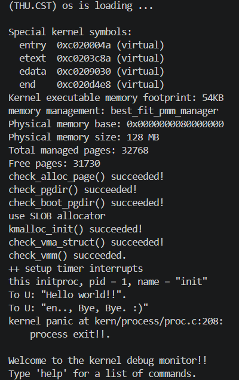
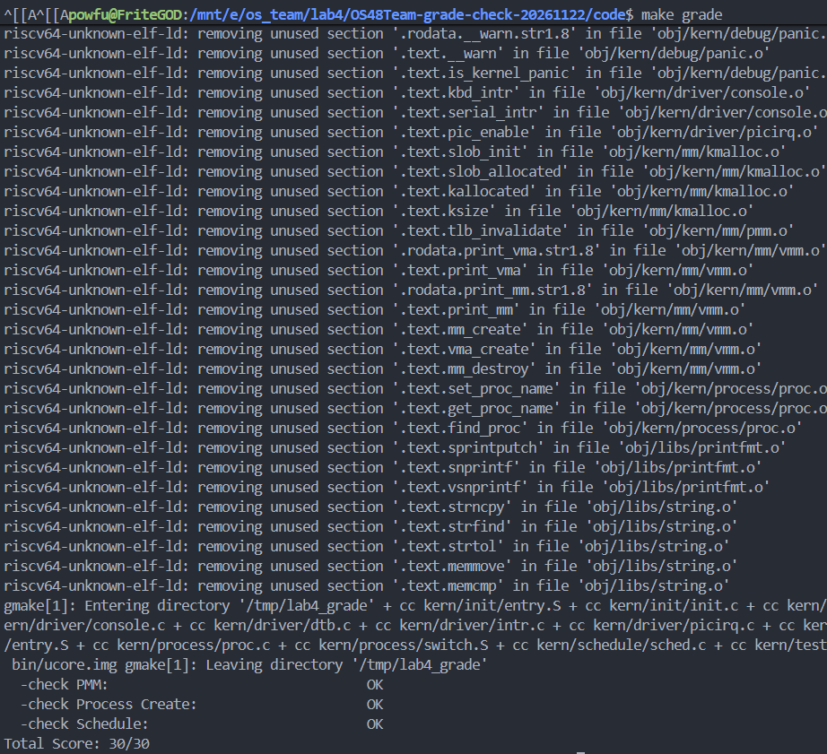

# 操作系统实验报告

## 实验基本信息

| 项目 | 内容 |
|------|------|
| **实验名称** | Lab 4: 进程管理 |
| **小组成员** | 2413195-钟沁涵、2413467-徐熙凯、2413533-蔡芷涵 |
| **完成日期** | [小组完成后填写] |

### 小组分工

练习如何分工？

| 成员 | 负责的练习/模块 |
|------|----------------|
| 2413195-钟沁涵 | 模块一：虚拟内存页操作，迁移 Best Fit 和物理内存初始化，完成分页模式 Challenge。 |
| 2413467-徐熙凯 | 模块二：进程创建与初始化。 |
| 2413533-蔡芷涵 | 模块三：进程调度与上下文切换，中断状态保存与恢复 Challenge，小组联调。 |

实验报告如何分工？

成员 A 编写模块一和分页模式 Challenge，并整合小组报告。成员 B 编写模块二。成员 C 编写模块三、中断相关 Challenge，并提供小组联调与评分截图。B、C 的实现细节、提示词、迭代记录及个人总结由各自填写。

---

## 一、实验目的

本实验的主要目的是：

1. 理解 Sv39 多级页表的组织方式，掌握虚拟页映射的建立、替换与撤销。
2. 理解内核线程的创建、初始化、调度和上下文切换如何衔接。
3. 使用 AI 辅助分析既有代码与边界条件，并通过实际编译和小组运行验证实现。

---

## 二、实验环境

你们使用的 AI 工具

| 成员 | AI 编程工具 | 底层模型 | 备注 |
|------|------------|---------|------|
| 2413195-钟沁涵 | ChatGPT | GPT-6 | Windows 11、WSL2 Ubuntu 22.04、VS Code Remote WSL，使用 Make 和 RISC-V 64 交叉编译工具链。 |
| 2413467-徐熙凯 | Codex 桌面应用 | 未记录具体模型版本 | Windows、WSL2 Ubuntu，SiFive GCC 10.2.0、QEMU 4.1.1；在 WSL 编译验证。 |
| 2413533-蔡芷涵 | ChatGPT | GPT-6 | Windows、WSL Ubuntu、VS Code，使用 RISC-V 工具链及 QEMU 进行编译与联调。 |

**说明：**
- **AI 编程工具**：指具体使用的终端工具、编辑器插件、桌面应用或浏览器界面
- **底层模型**：指该工具使用的大语言模型及版本

---

## 三、实验整体逻辑分析

### 2.1 本章节的逻辑主线

本实验围绕内核线程的建立和运行展开。内核先准备物理页及虚拟内存映射，再建立线程控制块、内核栈和初始上下文，最后由调度器选择可运行线程并完成上下文切换。成员 A 负责其中的内存管理部分，为页表和后续内核资源分配提供基础。

### 2.2 功能的逐步实现

1. **迁移物理内存管理并补齐页表操作。** `page_init()` 建立物理页描述信息并把空闲页交给 Best Fit。具备物理页分配能力后，`get_pte()` 才能在需要时申请中间页表页，映射接口才能更新具体页表项。
2. **建立并初始化内核线程。** 内核需要先准备可供调度的线程对象，包括控制块、内核栈和初始执行状态。
3. **调度和切换内核线程。** 待线程进入可运行状态后，再由调度器选择目标线程，保存原线程现场，恢复目标线程现场。

---

## 四、实验内容与实现

### 功能模块：虚拟内存页操作

**负责人：** 2413195-钟沁涵

#### 模块功能描述

**需要实现/修改的函数：**

```c
// code/kern/mm/default_pmm.c
static void best_fit_init(void);
static void best_fit_init_memmap(struct Page *base, size_t n);
static struct Page *best_fit_alloc_pages(size_t n);
static void best_fit_free_pages(struct Page *base, size_t n);
static size_t best_fit_nr_free_pages(void);
static void best_fit_insert_block(struct Page *base);

// code/kern/mm/pmm.c
static void page_init(void);
int page_insert(pde_t *pgdir, struct Page *page, uintptr_t la, uint32_t perm);
void page_remove(pde_t *pgdir, uintptr_t la);
static void page_remove_pte(pde_t *pgdir, uintptr_t la, pte_t *ptep);
void tlb_invalidate(pde_t *pgdir, uintptr_t la);
```

**功能说明：**

本模块在 `default_pmm.c` 中通过 `default_pmm_manager` 接入迁移后的 Best Fit 分配器。Best Fit 从能满足申请的空闲块里选择最小的一块，必要时拆分空闲块，释放后尝试与相邻空闲块合并。`page_init()` 根据设备树返回的物理内存范围，设置物理页描述符数组，并将可用页交给分配器。

`page_insert()` 借助骨架已有的 `get_pte()` 定位页表项。首次映射时增加目标页引用。重复映射到同一个物理页时更新权限，引用计数保持原值。改映射到另一物理页时，先撤销旧映射，再增加新页引用并安装新表项。`page_remove()` 查找已有映射，调用 `page_remove_pte()` 清除有效表项、使旧的 TLB 翻译失效并减少原物理页引用。计数降为零时回收物理页。删除不存在的映射时直接返回。

#### 最终提示词

以下提示词根据本次实验的实际讨论、源码和验证步骤整理。

````markdown
[PROMPT]
对照老师提供的 Lab4 骨架和小组已同步的 Lab3 源码，分析 Best Fit、
page_init() 的迁移位置，并协助实现 page_insert() 与 page_remove()。

[RELY]
使用骨架已有的 default_pmm_manager、get_pte()、pte_create()、
页引用计数接口、free_page() 和 tlb_invalidate()。
对照 pmm.c 中的 check_pgdir() 和 tools/test_lab4.c 的 PMM 测试。

[GUARANTEE]
首次映射、替换映射、同页权限更新和重复删除后的页表项与引用计数正确。
保留实验注释和老师提供的测试代码。给出 WSL 中可执行的目标文件编译命令。

[SPECIFICATION]
插入时允许创建缺失的中间页表，定位失败返回 -E_NO_MEM。
删除时只查找已有表项。清除旧映射后刷新 TLB，再按引用计数回收物理页。
同页更新只重写页表项及其权限。测试传入 0 或仅 PTE_W 时，补齐合法叶表项所需的读权限。
````

#### 实现迭代过程

本模块的实现经历了 2 次迭代，过程如下：

---

##### 第一次迭代

**遇到的问题：**

- 导入 Lab4 骨架后，对照压缩包发现 `default_pmm.c` 含有对 `best_fit_pmm.h` 的引用，但骨架内没有该头文件。旧实验的分配器实现通过 `best_fit_pmm_manager` 导出，Lab4 的初始化代码通过 `default_pmm_manager` 接入。
- Lab4 的 `pmm_init()` 已经包含页表检查和内核动态分配器的初始化流程。迁移时需要落实 `page_init()` 及其依赖常量，同时保留这些 Lab4 调用。

**问题解决策略：**

- 在分析迁移位置时明确保留骨架的分配器入口及检查函数。将旧版 Best Fit 逻辑接到 `default_pmm_manager`，使用骨架已有的 `default_pmm.h`。
- 按两个 `lab2` 标记插入对应代码，物理内存初始化只迁移 `page_init()` 及其相关常量。

**最终结果：**

`default_pmm.c` 和 `pmm.c` 均通过 RISC-V 目标文件编译。

---

##### 第二次迭代（如有）

**遇到的问题：**

- 同一个虚拟地址更新到原来的物理页时，如果先撤销旧映射，物理页只有一次引用的情况下可能被提前释放。
- 测试使用 `perm = 0` 和仅带 `PTE_W` 的参数。按 Sv39 的页表项编码，这两种情况需要补齐读位才能形成合法的目标页映射。

**问题解决策略：**

- 在设计中明确分开同页更新和换页两种路径。同页更新保持引用计数，换页时复用 `page_remove_pte()` 处理旧页。删除时先清空页表项、刷新旧翻译，再减少旧页引用计数。给 `sfence.vma` 的内联汇编加上 `"memory"` 约束，使编译器保留内存更新与刷新的顺序。
- 对上述两个测试权限组合补上 `PTE_R`，显式只执行权限仍按原值写入。

**最终结果：**

`git diff --check` 无错误输出，补齐页表函数后 `pmm.c` 重新编译成功。代码已推送到 `lab4`，提交为 [`10de740`](https://github.com/CheriaAshley/OS48Team/commit/10de7401f49797a2c043b52aa9f2a1f4b2fc3c23)。

**关键改进点总结（如有）：**

明确同页更新、换页及重复删除分别如何处理。用现有框架接口统一维护页表项、物理页引用和 TLB，按实际命令记录编译结果。

---

##### 第三次迭代（如有）

<!-- 成员 A 当前记录两次迭代。 -->

---

### 功能模块：进程创建与初始化

**负责人：** 2413467-徐熙凯（成员 B）

#### 模块功能描述

本模块在 `kern/process/proc.c` 完成六个函数。`alloc_proc()` 分配并清零 PCB，设置初始状态 `PROC_UNINIT`、未分配 PID `-1`、内核页表物理地址及链表节点。`proc_init()` 初始化进程链表和 PID 哈希表，把当前启动现场包装为 PID 0 的 `idleproc`，复用 `bootstack`，设置 `current` 和重调度标记，再创建 PID 1、名为 `init` 的线程。

`kernel_thread()` 构造临时 trapframe：`s0` 保存目标函数，`s1` 保存参数，`epc` 指向 `kernel_thread_entry`，设置 `SPP`、`SPIE` 并清除 `SIE`。它调用 `do_fork()`，由后者依次分配 PCB、内核栈、处理地址空间接口、构造首次执行现场，然后在保存并关闭本地中断的临界区内分配 PID、登记链表与哈希表、增加进程数并唤醒线程。返回值是新线程 PID；资源不足时返回负错误码。

`copy_mm()` 依据当前实验只创建内核线程的前提，断言 `current->mm == NULL`，保持新线程 `mm == NULL`，不实现用户地址空间复制。`copy_thread()` 把 trapframe 复制到新线程内核栈高端，设置子线程 `a0 = 0`，设置初始 `sp`，并令 `context.ra = forkret`、`context.sp = proc->tf`。非零传入栈地址保存在 `tf->gpr.sp`；内核线程传入零时使用 trapframe 地址。

首次执行的设计链路为 `switch_to -> forkret -> forkrets -> __trapret -> sret -> kernel_thread_entry -> init_main`。`context` 是供 `switch_to` 使用的精简调用现场，trapframe 则是供 `sret` 恢复的完整现场。骨架 `kernel_thread_entry` 用 `move a0, s1` 传参数，再用 `jalr s0` 调用线程函数，返回后调用 `do_exit()`。当前 `do_exit()` 的 panic 是实验骨架占位行为，不属于 B 的退出回收实现。

#### 最终提示词与 Spec

依赖条件是 RV64、已有 PMM/SLOB、`wakeup_proc()`、PID 分配与登记辅助函数，以及骨架首次运行入口。要求只补齐模块二六个函数，保留实验标记并填写学号，不覆盖 A 的内存模块或 C 的调度模块。PCB 必须初始化完整；创建失败不能登记半成品线程，且应按申请资源的逆序回收；成功后 PID 唯一、父子关系正确、状态为 `PROC_RUNNABLE`。地址空间仅支持本实验的内核线程场景。

提示词及回答的整理见 [prompt.md](prompt.md) 的成员 B 部分。使用 AI 后同时检查代码、编译结果及运行断言，不能把单文件编译等同于全系统完成。

#### 实现迭代过程及验证

2026-11-21 从远端 `lab4` 分支提交 `6d21c0b` 克隆独立工作目录。检查发现 A 的页映射与 Lab2 迁移代码已填写，C 的 `cpu_idle()`、`proc_run()`、`schedule()`、`switch_to()` 和 Lab3 迁移尚未填写，B 区域也是占位注释。按上述 Spec 补齐 B 六个函数，首次目标文件编译通过。

尝试原始 `make grade` 时，链接报告 `cpu_idle`、`schedule` 未定义；评分脚本随后未正常结束，由外层 15 秒超时终止。因此当前没有完整评分成绩，不能写成整组实验或首次调度已通过。

为独立验证 A/B，在 WSL `/tmp` 的副本运行老师原有注入器，保留 PMM、Process Create 测试，在 `proc_init()` 返回后执行附加检查并主动关机。尚未完成的 C 函数仅使用遇到即 panic 的测试边界占位；不运行调度、不打开时钟中断。这些占位、注入和故障模拟仅存在于临时测试副本，没有写进提交代码，也没有修改仓库中的老师测试。

实际结果：

```text
check_alloc_page() succeeded!
check_pgdir() succeeded!
check_boot_pgdir() succeeded!
[Test PMM] PASS
[Test Process Create] PASS
[B frame and first-entry setup] PASS
[B failure cleanup and process limit] PASS
[B PID, registration, explicit stack] PASS
[B component tests] PASS (scheduler and trap return not exercised)
```

附加检查覆盖 trapframe 栈位置、入口及函数参数、SPP/SPIE/SIE、context、PID 哈希登记、父进程、独立内核栈和非零栈参数。故障注入覆盖 PCB 分配失败、内核栈分配失败、地址空间接口失败，以及进程数量达到上限；验证错误码、未新增进程、PCB 分配与回收计数匹配、空闲页数量不变。`copy_mm()` 在当前正常场景不会失败，其失败分支通过临时测试包装验证。记录见 [模块二验证记录](verification/lab4-b-verification.txt)。本轮没有发现 B 实现导致的断言失败，不虚构额外修复迭代。

#### 与成员 C 的接口及待联调事项

`context.ra/sp` 对应 `switch_to()` 恢复的 `ra/sp`；`forkrets()` 已在 Lab4 骨架中提供，迁移 Lab3 时必须保留。`RESTORE_ALL` 应恢复 trapframe 中的返回状态，尤其注意 `tf->gpr.sp` 的语义，不应机械复制只增加固定栈大小的旧实现。C 完成后需要使用原始 `make grade` 验证调度测试和 initproc 输出，实际跟踪首次执行链路。完整成绩以该次联调为准。

#### 原理理解与 AI 协作

创建线程需要把 PCB、内核栈、地址空间描述、初始执行现场和可运行状态组织成一致实体；创建成功不意味着已经获得 CPU，实际执行依赖调度与上下文切换。本实验内核线程共享内核地址空间，没有实现用户进程地址空间复制、写时复制及完整退出回收。AI 协作中需明确字段语义、模块边界和可观测验收条件；测试结果要区分静态现场准备、模块运行和整组调度，不能用测试占位替代未完成队友模块后宣称整组通过。


---

### 功能模块：进程调度与上下文切换

**负责人：** 2413533-蔡芷涵

#### 模块功能描述

**需要实现/修改的函数：**

```c
// code/kern/process/proc.c
void cpu_idle(void);
void proc_run(struct proc_struct *proc);

// code/kern/schedule/sched.c
void schedule(void);

// code/kern/process/switch.S
void switch_to(struct context *from, struct context *to);
```

**功能说明：**

本模块负责实现内核线程的基本调度与上下文切换，使系统能够从仅完成线程创建的状态，进一步具备实际执行内核线程的能力。模块以 `idleproc` 和 `initproc` 为主要运行场景，通过调度器选择可运行线程，并完成 CPU 执行现场的保存与恢复。
`cpu_idle()` 是空闲线程的执行入口，通过循环检查当前线程的 `need_resched` 标志，在需要重新调度时调用 `schedule()`。`schedule()` 负责清除调度标志、遍历进程链表，并根据进程状态选择下一个处于 `PROC_RUNNABLE` 状态的线程。如果没有找到其他适合运行的线程，则使用空闲线程作为保底选择。
`proc_run()` 负责执行具体的线程切换操作。在切换过程中，先保护中断状态，再更新 `current` 指针，设置目标线程对应的页表基址并刷新 TLB，最后调用 `switch_to()` 完成上下文切换。`switch_to()` 使用 RISC-V 汇编保存原线程的 `ra`、`sp` 和 `s0`～`s11` 寄存器，并恢复目标线程的对应寄存器，使 CPU 能够继续执行目标线程。
在 Lab4 的实际运行过程中，`proc_init()` 完成 `idleproc` 和 `initproc` 的初始化后，内核进入 `cpu_idle()`。调度器选中 `initproc`，通过 `proc_run()` 和 `switch_to()` 切换到新线程。由于新线程的初始上下文已设置好 `forkret` 入口，因此能够继续经过 `forkrets` 和 `__trapret` 恢复执行现场，最终进入 `init_main()`，完成内核线程的首次运行。
#### 最终提示词

以下提示词根据本次实验中成员 C 的实际任务、AI 辅助实现过程及后续联调经验整理，属于最终采用的需求描述和约束总结，并非逐字聊天记录。

**[PROMPT]**

请基于老师提供的 riscv64-ucore Lab4 工程，协助完成进程调度与上下文切换模块。需要实现 `cpu_idle()`、`schedule()`、`proc_run()` 和 `switch_to()` 四个函数，使已经创建的 `initproc` 能够获得 CPU 并正常执行。请结合原始代码逐处给出修改位置和实现方法，不要直接覆盖完整文件。

**[RELY]**

依赖现有的 `struct proc_struct`、`struct context`、`current`、`idleproc`、`proc_list`、`need_resched`、`PROC_RUNNABLE` 以及 `local_intr_save()`、`local_intr_restore()` 等接口。复用成员 B 完成的进程创建与初始化代码，保留 Lab4 原有的 `forkret`、`forkrets` 和 `__trapret` 首次执行链路。

**[GUARANTEE]**

调度过程应正确选择可运行线程，避免在修改进程状态与执行现场时受到中断干扰。上下文切换应完整保存和恢复 RISC-V 调用约定要求的寄存器，保证线程再次被调度时能够继续运行。不得随意修改其他成员负责的模块，也不得以单文件编译通过代替完整系统运行验证。

**[SPECIFICATION]**

1. `cpu_idle()` 持续检查当前线程的重调度标志，满足条件时调用 `schedule()`。
2. `schedule()` 遍历进程链表，选择处于 `PROC_RUNNABLE` 状态的线程；没有合适的其他线程时，保证系统仍有可执行的空闲线程。
3. `proc_run()` 在中断保护下更新 `current`，切换目标线程的页表，刷新 TLB，并调用 `switch_to()`；目标线程已经是当前线程时不重复切换。
4. `switch_to()` 使用 RISC-V 汇编保存旧线程的 `ra`、`sp`、`s0`～`s11`，并从新线程上下文恢复相同寄存器。
5. 在完整工程中执行编译、QEMU 运行和评分测试，重点验证 `idleproc` 能够切换到 `initproc`，并保留真实运行结果。对于启动失败和评分异常，应先区分环境问题与代码问题，再进行修复。

具体的 AI 交互、代码调整和错误排查过程，在 `prompt.md` 的成员 C 部分进一步记录。
#### 实现迭代过程

##### 第一次迭代

**遇到的问题：**
Lab4 初始工程中，成员 C 负责的 `cpu_idle()`、`schedule()`、`proc_run()` 和 `switch_to()` 尚未完成，内核虽然具备部分进程创建相关的数据结构和接口，但缺少真正执行线程调度及上下文切换的实现。同时，Lab4 需要复用 Lab3 的中断与异常处理代码，因此还必须考虑新旧工程的文件差异，以及与其他成员代码的接口衔接问题。
**问题解决策略：**
首先根据实验指导书梳理四个函数之间的调用关系，并通过 AI 辅助分析现有的 `proc_struct`、`context`、`proc_list` 和中断控制接口。在原始文件上逐处补充实现，而不是整体替换工程。
在 `cpu_idle()` 中循环检查 `need_resched`；在 `schedule()` 中遍历进程链表并选择可运行线程；在 `proc_run()` 中保护中断状态、更新当前线程并切换执行现场；在 `switch_to()` 中使用 RISC-V 汇编保存及恢复 `ra`、`sp` 和 `s0`～`s11` 寄存器。
随后将成员 C 已完成的代码合并到包含成员 B 最新进程创建实现的 `lab4` 工程，并对 Lab3 的 `trap.c`、`trapentry.S` 与 Lab4 文件进行差异检查，保留 Lab4 首次线程运行所需的 `forkrets` 接口。
**阶段验证结果：**
四个核心函数完成后，进行了目标文件编译检查，并在整合后的工程中执行 `make`。编译和链接成功，生成了内核文件及启动镜像，说明代码能够完成构建。
但首次执行默认 QEMU 启动命令时，终端仅显示 OpenSBI 启动信息，未进入预期的 uCore 内核输出。因此，第一次迭代只能确认代码完成并通过编译，尚不能证明完整进程调度正常运行，需要继续排查启动问题。
##### 第二次迭代（如有）

**遇到的问题：**

完成各模块代码整合后，虽然 `make` 能够成功编译并链接内核，但使用默认 QEMU 启动方式时，终端仅显示 OpenSBI 信息，无法进入预期的内核初始化流程。随后使用 QEMU 监视器检查 CPU 寄存器及异常状态，发现启动过程中出现指令页错误。

在调整启动映射后，系统能够进入内存管理初始化阶段，但继续运行时又出现 `store_page_fault`，故障地址为 `0x100`。进一步检查发现，Sv39 中间级页表项的权限设置与 RISC-V 页表规则不一致，相关测试断言也需要同步核对。

**问题解决策略：**

首先借助 AI 分析 `entry.S` 中的 `satp` 设置、启动页表和虚实地址映射关系，通过 QEMU 监视器检查页表内容。发现原有启动页表仅保留高地址映射，切换分页模式后，低地址执行阶段可能发生指令页错误。为验证这一判断，在本地联调中为启动页表增加低地址恒等映射，同时保留原有高地址映射。

随后通过调整 ELF 加载地址的方法启动 QEMU，使系统能够进入内核初始化。针对后续出现的页错误，结合异常地址和反汇编结果，将故障定位到 `check_boot_pgdir()` 中对虚拟地址 `0x100` 的写入测试。

检查 `get_pte()` 后，发现其创建中间级页表项时设置了 `PTE_U`。根据 Sv39 的页表规则，中间级页表项不应设置用户访问位，因此将相关页表项构造改为调用已有的 `ptd_create()`。修改后，原有 `check_pgdir()` 中针对根页表项 `PTE_U` 的断言不再适用，于是同步调整断言，使其检查中间级页表项的用户位为 0，而不是简单删除测试。

上述修改涉及成员 A 负责的内存管理文件及公共启动代码，联调过程中进行了备份，并在小组沟通后保留修复，没有将这些修改作为成员 C 独立完成的内存管理任务。

**阶段验证结果：**

重新编译并运行后，内核依次输出：

```text
check_alloc_page() succeeded!
check_pgdir() succeeded!
check_boot_pgdir() succeeded!
kmalloc_init() succeeded!
check_vma_struct() succeeded!
check_vmm() succeeded.
this initproc, pid = 1, name = "init"
To U: "Hello world!!".
To U: "en.., Bye, Bye. :)"
```

这表明内存初始化检查能够通过，且系统成功执行了 `initproc` 内核线程，为进程调度与上下文切换模块提供了实际运行证据。

最终程序执行到 `do_exit()` 中尚未实现的退出逻辑，主动触发 `panic("process exit!!.\n")`。通过查看 `proc.c` 第 208 行附近的源码，确认该行为来自实验骨架中的占位实现，而非本次联调中新出现的未知异常。

第二次迭代解决了内核无法进入正常运行流程的问题，但尚未完成自动评分验证，因此继续开展第三次迭代。
##### 第三次迭代（如有）

**遇到的问题：**
在完成内核启动与进程运行联调后，使用原始 `make grade` 进行自动评分，结果为 `0/30`。PMM、Process Create 和 Schedule 三项均提示 `no $qemu_out`，说明评分程序未获得可用于检查的 QEMU 输出。由于此前手动运行已经成功执行 `initproc`，因此需要进一步区分程序功能错误与自动评分环境问题。
**问题解决策略：**
首先检查 `Makefile`、`tools/grade.sh` 和 `tools/inject.py`，确认评分程序会创建临时测试工程、注入测试代码，再使用 QEMU 和 GDB 控制执行。
通过对比发现，原评分脚本使用 `-device loader,file=bin/ucore.img,addr=0x80200000` 加载内核，而实际测试证明，使用 `-kernel bin/ucore.img` 能够正常进入内核并完成初始化。
随后在 `/tmp/lab4-grade-kernel-test` 中建立独立测试副本，不修改正式工程的评分脚本，将临时副本中的 QEMU 启动参数改为已经验证成功的 `-kernel` 方式。
直接运行注入测试后的内核，观察到 `[Test PMM] PASS`、`[Test Process Create] PASS` 和 `[Test Schedule] PASS`，说明三个测试模块均能够正常执行。
但此时自动评分仍为 `0/30`。继续检查评分日志与调试器配置，发现脚本指定的 `riscv64-unknown-elf-gdb` 在当前 WSL 环境中不可用，而系统已安装 `gdb-multiarch`。因此进一步将临时评分脚本使用的 GDB 修改为 `gdb-multiarch`，重新执行自动评分。
**最终验证结果：**
修正临时测试环境后，自动评分输出如下：

```text
-check PMM:             OK
-check Process Create:  OK
-check Schedule:        OK
Total Score: 30/30
```

上述结果表明，在调整后的临时评分环境中，物理内存管理、进程创建与进程调度三项测试均通过。其中，Schedule 测试的通过为成员 C 实现的调度与上下文切换功能提供了进一步验证。
需要说明的是，`30/30` 来自修正 QEMU 加载参数及 GDB 配置后的临时评分环境，并非未经修改的原始 `make grade`。正式工程的默认评分配置尚未同步修正，因此不能将原始评分结果直接记录为满分。
本次迭代中，AI 辅助逐步定位了启动方式与调试器配置差异。排查过程也表明，自动评分失败不一定意味着功能实现错误，应结合独立运行结果、测试输出与评分脚本行为综合判断。
后续小组联调中，成员 B 在其本地实验环境下使用原始 `make grade` 命令完成验证，PMM、Process Create 和 Schedule 三项测试全部通过，最终得分为 30/30。由此完成了小组的正式评分验证，相关截图见第五部分。
---


### Challenge：中断状态的保存与恢复

**负责人：** 2413533-蔡芷涵

本题要求分析 `local_intr_save(intr_flag); ... local_intr_restore(intr_flag);` 如何实现中断状态的保存与恢复，以及这种机制为什么能够保护内核中的关键操作。

**1. 中断开关的基本原理**

在 RISC-V 架构中，`sstatus` 寄存器的 `SIE` 位用于控制 S 模式下的全局中断使能状态。当 `SIE=1` 时，处理器允许响应已使能的相应中断；当 `SIE=0` 时，这些中断暂时不能打断当前 S 模式执行流程。

`intr_enable()` 和 `intr_disable()` 分别用于开启和关闭相应的中断使能状态。进程调度过程中需要修改 `current`、切换页表以及保存和恢复寄存器现场，这些操作应避免在状态尚未一致时被中断打断。

**2. `local_intr_save()` 的作用**

执行 `local_intr_save(intr_flag)` 时，首先保存当前中断是否开启的状态，然后关闭当前处理器的相关中断，使后续代码能够在受保护的临界区中执行。

其中，`intr_flag` 用于记录进入临界区之前的中断状态，而不是简单地固定为某个值。如果进入临界区之前中断已经关闭，就应记录这一状态，避免后续错误地重新开启中断。

**3. `local_intr_restore()` 的作用**

执行 `local_intr_restore(intr_flag)` 时，根据之前保存的 `intr_flag` 恢复中断状态。如果进入临界区前中断处于开启状态，则重新开启中断；如果原本处于关闭状态，则继续保持关闭。

因此，这两个操作不是简单地“关闭中断后再无条件开启”，而是实现了中断状态的保存和恢复，能够避免破坏调用者原有的中断控制状态。

**4. 在本实验中的应用**

在 `schedule()` 和 `proc_run()` 中，使用中断状态保护机制可以防止进程选择、`current` 更新、页表切换和上下文保存恢复过程中发生不合适的中断打断。

其基本使用形式为：

```c
bool intr_flag;
local_intr_save(intr_flag);

/* 执行需要保护的操作 */

local_intr_restore(intr_flag);
```

这种方式保护的是当前处理器上的临界区，不等同于多核环境下的全局互斥。若多个 CPU 需要同时访问共享数据，还需要使用自旋锁等同步机制。

**5. 总结**

`local_intr_save()` 和 `local_intr_restore()` 通过保存原中断状态、暂时关闭中断、执行临界区操作以及恢复原状态，实现了对关键代码的保护。在本实验的进程调度过程中，这一机制有助于保持进程控制信息、页表状态和实际执行现场的一致性，是实现可靠上下文切换的重要基础。

---

### Challenge：不同分页模式与 `get_pte()`

**负责人：** 2413195-钟沁涵

| 分页模式 | 普通 4 KiB 页的页表级数 | 每级索引位数 |
|---|---:|---:|
| Sv32 | 2 | 10 |
| Sv39 | 3 | 9 |
| Sv48 | 4 | 9 |

Sv39 从根页表到最底层需要向下走两次。`get_pte()` 的两段代码分别检查 `PDX1(la)`、`PDX0(la)` 对应的表项，必要时申请一个物理页存放下一级页表，清零后填写指向它的表项。两处承担相同的遍历操作，只是索引和层级不同。最后使用 `PTX(la)` 返回叶级表项的位置。

查找与分配可以共用遍历过程，`create` 参数决定是否允许创建中间页表。`page_remove()` 传入 `0`，`page_insert()` 传入 `1`。若需要进一步区分接口语义，可以对外提供只查找和允许创建的两个入口，内部仍复用同一份遍历逻辑。

---

## 五、测试与验证

**测试截图：**



图1：内核成功完成初始化及内存管理检查，并调度 initproc 执行。



图2：小组使用原始 make grade 进行验证，PMM、Process Create 和 Schedule 三项测试全部通过，总分为 30/30。


---

## 六、实验总结与收获

### 对操作系统的理解

1. **2413195-钟沁涵：已对应的操作系统原理。** Best Fit 解决连续物理页的选取和回收。多级页表记录虚拟页到物理页的映射及权限。TLB 缓存硬件翻译结果，因此修改表项后还需要处理旧翻译。引用计数则记录物理页的使用情况，用来判断撤销一条映射后物理页是否可以被回收。
2. **2413195-钟沁涵：后续实验涉及的知识点。** 本模块采用预映射方式。按需分页、页面换入换出以及页面置换还需要结合缺页异常和后备存储实现。
3. **2413533-蔡芷涵：已对应的操作系统原理。** 本模块涉及进程调度、上下文切换和临界区保护。`schedule()` 根据进程状态选择可运行线程，`proc_run()` 将调度结果落实到实际执行现场，`switch_to()` 保存和恢复 `ra`、`sp`、`s0`～`s11` 寄存器，使线程能够在不同执行阶段继续运行。`context` 主要用于线程切换，`trapframe` 则用于保存和恢复中断或异常现场。通过 `local_intr_save()` 和 `local_intr_restore()` 保存、关闭及恢复中断状态，保护调度过程中的关键操作。本实验还体现了进程创建与进程执行的区别：创建线程只是准备执行环境，真正运行还需要调度器和上下文切换机制。
4. **2413533-蔡芷涵：后续实验涉及的知识点。** 本模块实现了内核线程的基本调度与上下文切换，但尚未完整实现优先级调度、多级反馈队列、复杂的时间片管理、多核负载均衡，以及完整的进程退出和资源回收机制。后续还需要进一步学习不同调度算法的性能差异、多处理器同步和更完整的进程生命周期管理。
<!-- 成员 B在此补充各自负责部分对应的操作系统原理及小组总结。 -->
### AI 协作开发的经验

**2413195-钟沁涵：** 迁移旧代码时，先给出旧版与新版的具体文件、实验标记和原有检查函数，可以更准确地定位需要复用的代码。设计页表接口时，把同页更新、换页、重复删除、分配失败分别写进 Spec，使实现后的检查有明确依据。完成修改后，用实际编译输出记录已验证的范围，并保留小组运行结果的位置。

<!-- 成员 B在此补充各自的 AI 协作经验。 -->
**2413533-蔡芷涵：** 本次实验中，我主要借助 AI 完成进程调度与上下文切换模块的设计、代码修改及联调排错。在实现初期，先根据实验指导书明确 `cpu_idle()`、`schedule()`、`proc_run()` 和 `switch_to()` 的功能边界，再结合原有代码逐处修改，避免直接替换整个文件而破坏其他成员的工作。迁移 Lab3 中断处理代码时，也需要对照 Lab4 原有结构，特别注意保留 `forkrets` 等首次线程运行所需的接口。
在联调阶段，AI 帮助分析 QEMU 启动异常、Sv39 页表映射、页错误及自动评分脚本的问题。但 AI 提出的判断并不一定正确，例如曾怀疑页表项缺少 `PTE_V`，进一步检查源码后发现已有接口会自动设置该标志，因此没有采用这一错误判断。后续通过查看实际代码、运行日志、异常地址和测试输出，逐步定位并解决问题。
这次经历让我认识到，AI 更适合作为代码分析和调试辅助工具，不能替代实际验证。尤其是在多人协作项目中，需要明确各模块的责任边界，区分代码错误、接口不匹配和环境配置问题，并如实记录测试条件。例如，本次自动评分最初在本人 WSL 环境中无法正常完成，经过排查后在临时调整的评分环境中取得 30/30；后续小组也在其他成员的环境中使用原始评分命令取得满分。这让我认识到，实验验证不仅需要关注最终得分，也需要准确记录测试条件和排错过程。
---
