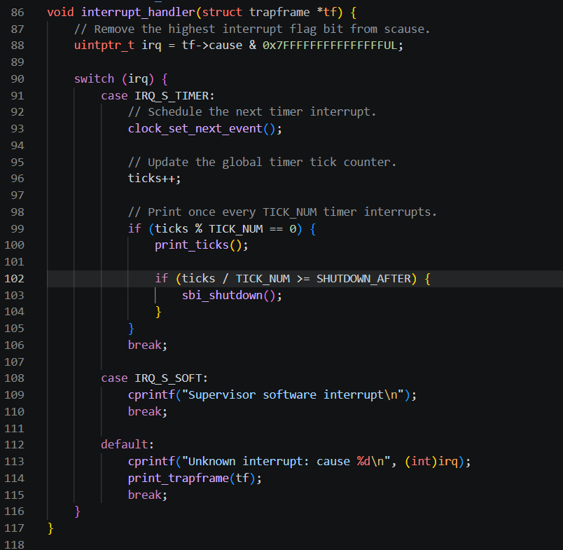
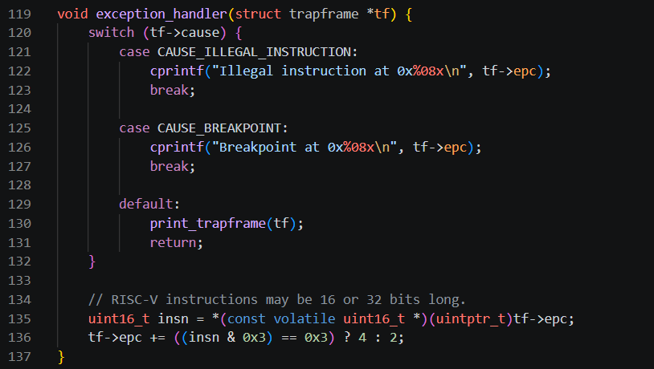
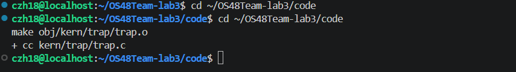
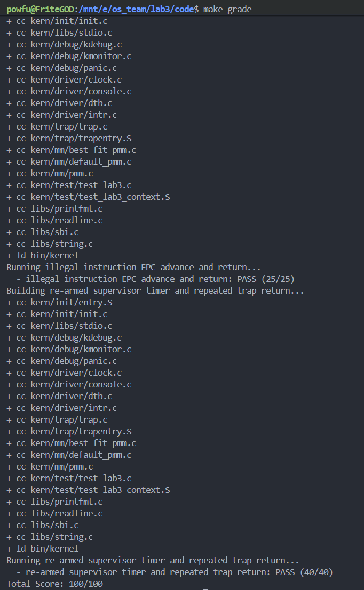

# 操作系统实验报告

## 实验基本信息

| 项目 | 内容 |
|------|------|
| **实验名称** | Lab 3：中断与异常处理 |
| **小组成员** | 2413195-钟沁涵、2413467-徐熙凯、2413533-蔡芷涵 |
| **完成日期** | 2026年11月6日 |

### 小组分工

本实验按照 Trap 上下文恢复、Trap 入口与返回、中断与异常处理三个部分进行分工，三位成员分别承担代码实现、调试验证、AI 提示词设计及对应实验报告的编写工作。

| 成员 | 负责的练习/模块 |
|------|----------------|
| 2413195-钟沁涵 | 负责 `RESTORE_ALL` 宏的实现，分析 `SAVE_ALL` 与 TrapFrame 的数据布局，完成寄存器及相关 CSR 状态恢复；负责实验目的、实验环境、上下文恢复部分的报告编写，以及最终报告整合。 |
| 2413467-徐熙凯 | 负责 `__alltraps` 的实现及 Trap 入口与 C 语言处理函数之间的调用关系；负责实验整体执行流程、Trap 入口与返回机制及相关报告内容。 |
| 2413533-蔡芷涵 | 负责 `interrupt_handler()` 和 `exception_handler()` 的实现，完成时钟中断、非法指令异常及断点异常处理；负责中断与异常处理部分的报告及测试结果整理。 |

**实验报告分工：**

- **成员一：** 编写实验目的、实验环境、Trap 上下文保存与恢复原理及实现、对应 Spec 与 Prompt、Bug 分析和测试结果，并负责最终报告格式统一与整合。
- **成员二：** 编写实验整体逻辑流程、Trap 入口与返回机制、对应 Spec 与 Prompt、Bug 分析，以及本实验未覆盖的重要操作系统知识点。
- **成员三：** 编写中断与异常处理模块、对应 Spec 与 Prompt、Bug 分析、测试结果，以及实验知识点与操作系统原理对照的初稿。

---

## 一、实验目的

本实验以 RISC-V 64 架构下的操作系统内核为基础，实现 Trap 上下文恢复、Trap 入口及中断与异常处理功能，理解操作系统对突发事件的响应机制。

本实验的主要目的是：

1. 理解 RISC-V 的中断与异常处理机制，掌握 `stvec`、`sstatus`、`sepc`、`scause` 等控制与状态寄存器的作用，了解 Trap 从触发、分发到返回的完整执行流程。
2. 掌握 TrapFrame 的数据组织方式及 CPU 上下文保存与恢复原理，结合 `SAVE_ALL` 完成 `RESTORE_ALL`，实现通用寄存器和相关控制状态的正确恢复。
3. 理解 Trap 汇编入口与 C 语言处理函数之间的调用关系，实现时钟中断、非法指令异常和断点异常的基本处理，并通过编译及运行测试验证实现的正确性。
4. 学习根据实验接口、数据结构及功能约束设计 Spec 和 Prompt，使用 AI 辅助实现操作系统功能，结合编译错误与测试结果检查、修正生成代码。

---

## 二、实验环境

成员 A 在 Windows 11 主机上，通过 WSL2 Ubuntu 22.04 进行开发，使用 VSCode 编辑代码，采用 RISC-V 交叉编译工具链构建内核，并使用 QEMU 进行模拟运行与调试。

成员 A 的主要实验环境如下：

| 项目 | 配置 |
|------|------|
| 主机操作系统 | Windows 11 |
| Linux 实验环境 | WSL2 Ubuntu 22.04 |
| 代码编辑工具 | Visual Studio Code（Remote WSL） |
| 目标架构 | RISC-V 64 |
| 交叉编译工具链 | `riscv64-unknown-elf-gcc` |
| 构建工具 | GNU Make |
| 模拟运行环境 | QEMU RISC-V 64 |
| 版本管理 | Git、GitHub |
| 实验仓库 | `OS48Team` |
| 实验分支 | `lab3` |
| 实验代码目录 | `/home/asus/oslab/OS48Team/code` |

### 成员 B 的实验环境

| 项目 | 配置 |
|---|---|
| 宿主操作系统 | Windows |
| Linux 实验环境 | WSL2 Ubuntu 26.04.1 LTS，x86_64 |
| 代码编辑工具 | Visual Studio Code（Remote WSL） |
| 交叉编译工具链 | SiFive GCC-Metal 10.2.0-2020.12.8 |
| 模拟运行环境 | QEMU 4.1.1，随附 OpenSBI v0.4 |
| 调试工具 | SiFive GDB-Metal 10.1.0-2020.12.7；本轮验收采用课程自动测试 |
| 实验分支 | `lab3` |
| 实验代码目录 | `/mnt/e/os_team/lab3/code` |
| 本轮验证日期 | 2026-11-07 |

### 成员 C 的实验环境

| 项目 | 配置 |
|---|---|
| 宿主操作系统 | Windows |
| Linux 实验环境 | WSL2 Ubuntu 24.04 |
| 代码编辑工具 | Visual Studio Code（Remote WSL） |
| 目标架构 | RISC-V 64 |
| 交叉编译工具链 | RISC-V 64 交叉编译工具链 |
| 构建工具 | GNU Make |
| 版本管理 | Git、GitHub |
| 实验仓库 | `OS48Team` |
| 实验分支 | `lab3` |
| 实验代码目录 | `~/OS48Team-lab3/code` |

### AI 工具使用情况

| 成员 | AI 编程工具 | 底层模型 | 备注 |
|------|-------------|----------|------|
| 2413195-钟沁涵 | ChatGPT | GPT-6 | 辅助分析 TrapFrame 布局、实现 `RESTORE_ALL`、排查汇编错误及整理实验报告 |
| 2413467-徐熙凯 | Codex 桌面端 | GPT-6 | Trap 入口调用实现、接口约束分析、编译和评分验证、报告整理 |
| 2413533-蔡芷涵 | ChatGPT | GPT-6 | 辅助分析 TrapFrame 与中断、异常处理逻辑，完善`interrupt_handler()` 和 `exception_handler()`，排查代码编译及测试问题，并协助整理实验报告 |

本实验采用老师提供的 Lab3 代码框架，在独立的 `lab3` Git 分支中完成开发。根据实验分工，分别实现 Trap 上下文恢复、Trap 入口调用及中断与异常处理功能，通过 Git 管理代码修改和小组协作过程。

实验过程中，使用 `make` 进行项目构建，并通过单独编译 `trapentry.S` 检查上下文恢复部分的汇编代码。完整系统的运行测试在各功能模块集成后进行。

---

## 三、实验整体逻辑分析

### 3.1 本章节的逻辑主线

本实验在已有物理内存管理和页表机制的基础上，为 RISC-V 64 操作系统内核增加 Trap 上下文保存与恢复、中断及异常处理功能，使内核能够响应时钟中断和程序执行过程中产生的异常。

实验整体按照以下逻辑逐步实现：

1. **建立 Trap 入口机制。** 在内核初始化阶段，通过 `idt_init()` 设置 `stvec`，使 CPU 在发生对应 Trap 时能够进入汇编入口 `__alltraps`。

2. **实现上下文保存与恢复。** 通过 `SAVE_ALL` 将通用寄存器及相关控制状态保存到 TrapFrame，利用 `RESTORE_ALL` 恢复寄存器及必要的 CSR 状态，保证处理结束后能够继续原来的执行流程。

3. **完成中断与异常分发。** 汇编入口将 TrapFrame 指针传递给 C 语言函数 `trap()`，由 `trap_dispatch()` 判断 Trap 类型，再调用 `interrupt_handler()` 或 `exception_handler()` 完成具体处理。

4. **初始化时钟并开启中断。** 通过 `clock_init()` 配置时钟中断，调用 `clock_set_next_event()` 安排首次时钟事件，再通过 `intr_enable()` 开启 S 模式全局中断使能。

5. **处理事件并恢复执行。** 时钟中断发生后，系统更新中断计数并安排下一次事件；异常发生后，根据具体原因执行相应处理。完成处理后，通过 `RESTORE_ALL` 恢复上下文，最后由 `sret` 返回原来的执行流程。

本实验主要解决了内核在发生中断或异常时，如何保存当前执行状态、进入处理程序以及在处理完成后恢复执行的问题，为后续进程调度和系统调用等操作系统功能提供基础支持。

### 3.2 功能的逐步实现

本实验的功能按照依赖关系逐步组织，主要分为以下四个阶段。

1. **首先建立 TrapFrame 数据结构及上下文保存机制。**

   Trap 处理程序需要读取中断发生时的 CPU 状态，因此必须先明确上下文的数据布局。实验通过 `struct pushregs` 和 `struct trapframe` 描述保存的数据，并利用已有的 `SAVE_ALL` 将寄存器和相关 CSR 状态保存到内存中。该步骤为后续恢复及事件处理提供必要的数据基础。

2. **接着实现上下文恢复和 Trap 入口调用。**

   根据 `SAVE_ALL` 的保存布局实现 `RESTORE_ALL`，保证保存与恢复过程使用相同的寄存器偏移。同时，在 `__alltraps` 中完成 TrapFrame 指针传递及对 `trap()` 的调用。由于 C 语言处理函数可能修改通用寄存器，因此需要通过汇编代码保护原来的执行状态。

3. **然后完善中断与异常处理功能。**

   Trap 进入 C 语言处理程序后，利用 `trap_dispatch()` 根据 `tf->cause` 区分中断与异常，并分别调用对应的处理函数。其中，时钟中断需要更新 `ticks` 并设置下一次时钟事件，异常处理需要根据原因编号识别非法指令、断点等情况。

4. **最后完成上下文恢复和功能验证。**

   处理函数返回后，汇编代码通过 `RESTORE_ALL` 恢复寄存器和相关 CSR 状态，再执行 `sret` 返回。最后通过编译和运行测试检查 Trap 处理流程是否正确。由于各模块之间存在调用关系，需要在全部功能完成后进行集成验证。

整体执行流程如下：

```text
内核启动
    |
    v
kern_init()
    |
    +-- idt_init()       配置 Trap 入口
    |
    +-- clock_init()     初始化时钟中断
    |
    +-- intr_enable()    开启全局中断使能
    |
    v
正常执行程序
    |
    v
发生中断或异常
    |
    v
__alltraps
    |
    v
SAVE_ALL               保存上下文
    |
    v
trap()
    |
    v
trap_dispatch()
    |
    +-- interrupt_handler()  处理中断
    |
    +-- exception_handler()  处理异常
    |
    v
__trapret
    |
    v
RESTORE_ALL            恢复上下文
    |
    v
sret                   完成 Trap 返回
    |
    v
继续执行程序
```

---

## 四、实验内容与实现

### 功能模块一：Trap 上下文恢复

**负责人：** 2413195-钟沁涵

#### 模块功能描述

**需要实现或修改的函数及宏：**

```asm
.macro RESTORE_ALL
    # 恢复保存的寄存器与相关 CSR 状态
.endm
```

相关代码位置：

- `kern/trap/trapentry.S`：实现 `RESTORE_ALL`，参考已有的 `SAVE_ALL`。
- `kern/trap/trap.h`：读取 `struct pushregs` 和 `struct trapframe` 的定义，确认数据布局。

**功能说明：**

本模块负责在 Trap 处理结束后恢复 CPU 执行上下文，使程序能够从正确的位置继续执行。

进入 Trap 时，`SAVE_ALL` 将通用寄存器以及 `sstatus`、`sepc` 等相关状态保存到栈上的 TrapFrame 中。处理函数执行期间，部分寄存器可能被修改，因此返回前必须恢复原有状态。

本模块主要完成以下工作：

1. 根据 `struct trapframe` 的布局，确定通用寄存器和 CSR 状态在栈中的保存位置。
2. 从 TrapFrame 中读取 `sstatus` 和 `sepc`，恢复对应的控制与状态寄存器。
3. 按照 `SAVE_ALL` 的保存偏移，使用 `LOAD` 指令恢复各个通用寄存器。
4. 对 `x0` 和 `x2(sp)` 进行特殊处理。`x0` 恒为零，不需要恢复；`sp` 仍用于定位当前 TrapFrame，因此需要最后恢复。
5. 恢复完成后由 `__trapret` 执行 `sret`，完成 Trap 返回。

本实验采用 RV64 架构，`REGBYTES` 为 8。`SAVE_ALL` 通过以下指令分配 TrapFrame 空间：

```asm
addi sp, sp, -36 * REGBYTES
```

因此，TrapFrame 总计占用 288 字节，其中前 32 个寄存器槽位对应通用寄存器，后 4 个槽位保存相关 CSR 状态。

本模块与其他模块的关系是：`SAVE_ALL` 负责保存上下文，`trap()` 及其处理函数负责处理中断或异常，`RESTORE_ALL` 负责恢复执行状态。三者共同构成完整的 Trap 处理过程。

#### 最终提示词

本模块采用实验指导书要求的四段式提示词结构，将任务目标、已有依赖、交付要求和具体行为规范分别描述。提示词主要用于辅助分析 TrapFrame 数据布局、寄存器恢复顺序及汇编实现约束，为后续代码编写和调试提供依据。

**Spec 设计：**

本模块的 Spec 根据已有 `SAVE_ALL`、`struct pushregs` 和 `struct trapframe` 的定义进行设计，重点确定以下约束：

1. **数据布局一致性：** 恢复过程必须与 `SAVE_ALL` 使用相同的 TrapFrame 内存布局，寄存器读取偏移与保存偏移一一对应。
2. **控制状态恢复：** 明确 `sstatus` 和 `sepc` 的恢复方式，并正确衔接后续的 `sret` 指令。
3. **特殊寄存器处理：** `x0` 无需恢复；`x2(sp)` 需要保持 TrapFrame 的地址基准有效，在其他寄存器恢复完成后再调整。
4. **代码兼容性：** 使用实验框架提供的 `LOAD`、`REGBYTES` 等定义，遵守 RV64 汇编语法和现有文件结构。
5. **修改范围约束：** 仅针对成员 A 负责的 `RESTORE_ALL` 进行分析与实现，不修改其他成员负责的模块，并保留老师规定的 `lab3` 注释及学号标记。

**最终 Prompt：**

```text
[PROMPT]
分析 RISC-V 64 操作系统 Lab3 的 Trap 上下文恢复机制，
重点研究 kern/trap/trapentry.S 中 RESTORE_ALL 的实现思路。

请结合已有的 SAVE_ALL，说明寄存器恢复需要遵循的
内存布局、恢复顺序和汇编操作，并提出合理的实现步骤。
不直接给出完整的汇编实现代码。

[RELY]
可以依赖以下已有代码及定义：

1. kern/trap/trapentry.S 中已经实现的 SAVE_ALL。
2. kern/trap/trap.h 中的 struct pushregs 和
   struct trapframe 数据结构。
3. libs/riscv.h 中已有的 REGBYTES、LOAD、STORE
   及 RISC-V CSR 相关定义。
4. RISC-V 64 的寄存器规则和函数调用约定。
5. 已有的 __trapret 返回流程及 sret 指令。

[GUARANTEE]
本模块需要完成的内容包括：

1. 明确 RESTORE_ALL 需要恢复的寄存器及 CSR 状态。
2. 分析寄存器保存与恢复之间的对应关系。
3. 给出 RESTORE_ALL 的实现流程和关键操作顺序。
4. 说明 x0、x2(sp) 等特殊寄存器的处理方法。
5. 给出汇编代码检查和单独编译的验证思路。

仅分析和指导 RESTORE_ALL，不涉及 __alltraps、
interrupt_handler() 或 exception_handler() 的实现。

[SPECIFICATION]
1. 实验目标架构为 RISC-V 64，REGBYTES 为 8。
2. SAVE_ALL 使用 36*REGBYTES 分配 TrapFrame，
   前 32 个槽位保存通用寄存器及原始 sp，
   后 4 个槽位保存相关 CSR 状态。
3. sstatus 和 sepc 分别对应 TrapFrame 中
   32*REGBYTES 和 33*REGBYTES 的偏移。
4. 恢复寄存器时应使用已有的 LOAD 定义，
   并与 SAVE_ALL 中的 STORE 偏移对应。
5. x0 始终为零，无需从内存中恢复。
6. 恢复其他寄存器期间必须保持 sp 所指向的
   TrapFrame 有效，避免提前修改栈指针。
7. CSR 状态及通用寄存器恢复完成后，
   由后续 sret 指令完成 Trap 返回。
8. 不修改已有的 SAVE_ALL、TrapFrame 结构体
   和其他成员负责的功能模块。
9. 保留原有 lab3 标记，并按实验要求填写学号。
10. 所提出的实现方案应能够使用现有的
    RISC-V 交叉编译工具链进行汇编检查。

请按照“数据布局分析—恢复顺序设计—
关键指令说明—验证方法”的顺序给出指导，
重点解释各项设计的原因和需要注意的问题。
```


#### 实现迭代过程

本模块的实现经历了代码生成、单独编译和兼容性修正三个步骤。

##### 第一次迭代：实现 RESTORE_ALL

**实现过程：**

首先阅读 `trap.h` 和 `trapentry.S`，确认 `struct trapframe` 的数据布局及 `SAVE_ALL` 的寄存器保存方式。

根据已有的保存逻辑，在 `RESTORE_ALL` 中使用 `LOAD` 恢复寄存器，并通过 `csrw` 恢复相关 CSR 状态。

关键代码如下：

```asm
.macro RESTORE_ALL

    #lab3 function1 2413195

    # restore sstatus and sepc
    LOAD s1, 32*REGBYTES(sp)
    LOAD s2, 33*REGBYTES(sp)
    csrw sstatus, s1
    csrw sepc, s2

    # restore general purpose registers
    LOAD x1, 1*REGBYTES(sp)
    LOAD x3, 3*REGBYTES(sp)
    LOAD x4, 4*REGBYTES(sp)
    # 其余通用寄存器按照对应偏移依次恢复
    # 此处省略重复的 LOAD 指令

    # restore stack pointer
    addi sp, sp, 36*REGBYTES

.endm
```

以上代码为报告中的关键实现摘要，实际源文件中包含完整的通用寄存器恢复指令。

其中，`RESTORE_ALL` 先恢复 `sstatus` 和 `sepc`，再按照 TrapFrame 的布局恢复通用寄存器。最后执行 `addi sp, sp, 36*REGBYTES`，释放 TrapFrame 占用的栈空间。

**遇到的问题：**

首次执行完整项目编译时，`trap.c` 中的 `interrupt_handler()` 和 `exception_handler()` 尚未实现，编译器提示函数缺少声明。

该问题来自其他成员负责的待实现模块，不属于 `RESTORE_ALL` 本身的汇编错误。

**问题解决策略：**

为避免修改其他成员的代码，改为针对 `trapentry.S` 执行独立编译：

```bash
make obj/kern/trap/trapentry.o
```

此方式可以在其他模块尚未实现时，单独检查当前汇编文件能否通过编译。

执行后发现原始 `SAVE_ALL` 中存在 CSR 名称兼容问题，需要进一步修正。

##### 第二次迭代：修正 CSR 名称兼容问题

**遇到的问题：**

单独编译 `trapentry.S` 时，汇编器报告：

```text
kern/trap/trapentry.S:47:
Error: unknown CSR 'sbadaddr'
```

检查源代码发现，已有的 `SAVE_ALL` 使用了：

```asm
csrr s3, sbadaddr
```

其中 `sbadaddr` 是旧版 RISC-V 规范使用的 CSR 名称，当前交叉汇编器不识别该名称。

**问题解决策略：**

将其修改为当前工具链支持的 `stval`：

```asm
csrr s3, stval
```

`stval` 用于提供 Trap 相关的附加信息，与 TrapFrame 中的 `badvaddr` 成员对应。该修改不改变 TrapFrame 的布局，也不影响 `RESTORE_ALL` 的寄存器恢复逻辑。

修改后重新执行：

```bash
make obj/kern/trap/trapentry.o
```

终端输出：

```text
+ cc kern/trap/trapentry.S
```

命令正常结束，未再出现汇编错误。

**最终结果：**

经过上述实现与修正，本模块取得以下阶段性结果：

- [x] 完成 `RESTORE_ALL` 宏的实现。
- [x] 按照已有 TrapFrame 布局恢复寄存器。
- [x] 完成 `sp` 的特殊恢复处理。
- [x] 将对应 `YOUR CODE` 替换为个人学号，并保留 `lab3` 标记。
- [x] 修复 `sbadaddr` 的汇编器兼容问题。
- [x] `trapentry.S` 单独编译通过。
- [x] 完整 Trap 上下文恢复运行测试（2026-11-07 由成员 B 完成入口后，联合课程测试通过，详见第五节）。

成员 A 独立开发阶段通过了汇编检查，当时完整运行验证仍待集成。2026-11-07，成员 B 接通入口后，原有上下文与断点测试通过 35/35，课程总分为 100/100；原有 A 实现未修改。

**关键改进点总结：**

1. 根据 `SAVE_ALL` 的真实保存布局设计恢复过程，避免直接套用不匹配的通用汇编代码。
2. 对 `x2(sp)` 采用最后恢复的方式，保证读取 TrapFrame 期间栈指针保持稳定。
3. 发现并修正老师原始框架中的 CSR 名称兼容问题，使代码能够通过当前汇编工具链的检查。

---

### 功能模块二：Trap 入口与返回调用

**负责人：** 2413467-徐熙凯

#### 模块功能描述

本模块位于 `kern/trap/trapentry.S`，负责将已有的上下文保存、C 语言事件处理和上下文恢复连接起来。`idt_init()` 将 `__alltraps` 的地址写入 `stvec`，CPU 将需要由 S 模式处理的 Trap 交给该入口。入口执行 `SAVE_ALL` 后，当前 `sp` 指向栈上的 TrapFrame；随后按照 RISC-V 调用约定，将这一地址作为第一个参数传给 `trap(struct trapframe *tf)`。

`trap()` 根据 Trap 原因调用成员 C 的中断或异常处理函数，返回后继续执行已有的 `__trapret`，由成员 A 的 `RESTORE_ALL` 恢复现场，最终执行 `sret`。成员 B 不重复实现保存、恢复或具体事件处理，也不改变 TrapFrame 布局。

#### Spec 设计

1. **输入前提：** 已有 `SAVE_ALL` 正确保存当前现场；RV64 的 TrapFrame 占 36×8=288 字节，执行完成后 `sp` 指向结构体起点。
2. **参数约定：** 将 TrapFrame 的地址放入第一参数寄存器 `a0`，传递指针而不是结构体内容。
3. **调用约定：** 使用正常函数调用进入 `trap()`，生成有效返回地址，使 C 函数结束后回到汇编入口的后续位置。
4. **栈约束：** `trap()` 返回时，`sp` 必须恢复为调用前的 TrapFrame 基址；现有启动栈满足对齐要求，288 字节的帧也保持 16 字节栈对齐。
5. **返回约束：** 调用结束后衔接既有 `__trapret -> RESTORE_ALL -> sret`。不在入口额外跳过指令，异常返回位置由处理函数更新保存的 `tf->epc`。
6. **修改范围：** 只补 B 对应的 `YOUR CODE`，填写学号 2413467；保留 `SAVE_ALL`、`RESTORE_ALL`、`trap()` 签名、TrapFrame 结构和给定测试。

#### 最终 Prompt

以下将本次实际任务及实现约束整理为四段式提示词，AI 交互摘要另见 `prompt.md` 的成员二部分。

```text
[PROMPT]
在成员 A 已实现 RESTORE_ALL、成员 C 已实现中断和异常处理的
Lab3 框架上，完成成员 B 的 Trap 入口与返回调用，并填写报告。

[RELY]
依赖 trapentry.S 中的 SAVE_ALL、RESTORE_ALL、__trapret，
trap.h 中的 struct trapframe，以及 void trap(struct trapframe *tf)。
遵循 RV64 的函数调用约定和既有 288 字节 TrapFrame 布局。

[GUARANTEE]
将当前 TrapFrame 指针正确传入 trap()，正常调用并返回，保证
返回后 sp 仍指向原 TrapFrame，随后恢复现场并执行 sret。
运行课程 make grade 和正常内核运行验证，记录真实结果。

[SPECIFICATION]
第一个参数使用 a0；使用带返回地址的函数调用进入 trap()。
不在保存现场前破坏被中断程序的寄存器。
不额外移动 TrapFrame 或重复释放其栈空间。
不修改 A/C 的实现、TrapFrame 定义、函数签名或给定测试。
保留 lab3 注释，将 B 的 YOUR CODE 替换为学号 2413467。
只在本地实现和验证，不提交或推送。
```

#### 实现与关键指令

最终入口及返回代码如下：

```asm
__alltraps:
    SAVE_ALL

    #lab3 function1 2413467
    # Pass the saved Trap frame to trap(struct trapframe *tf).
    mv a0, sp
    jal trap
    # sp should be the same as before "jal trap"

    .globl __trapret
__trapret:
    RESTORE_ALL
    sret
```

其中新增的可执行代码只有 `mv a0, sp` 和 `jal trap`，后面的返回框架为原有代码。

| 指令或阶段 | 作用 |
|---|---|
| `SAVE_ALL` | 在栈上保存被打断时的寄存器与 CSR 信息，建立 TrapFrame。 |
| `mv a0, sp` | 将当前帧起点作为 `struct trapframe *tf` 传入，原来的 `a0` 已在保存阶段保留。 |
| `jal trap` | 调用 C 处理函数，返回地址写入 `ra`；被打断程序原来的 `ra` 已在 TrapFrame 中保存。 |
| C 函数返回 | 按 ABI 撤销自身的栈帧，回到调用后的指令位置，此时 `sp` 再次指向同一个 TrapFrame。 |
| `RESTORE_ALL` | 恢复保存的通用寄存器以及处理后的返回状态，恢复原来的栈指针。 |
| `sret` | 根据 `sepc` 和 `sstatus` 返回。返回级别由保存的 SPP 决定，并非一律返回 U 模式。 |

这里不能将 `jal trap` 替换成没有正常返回地址的直接跳转，否则无法按普通 C 函数调用关系可靠返回。`__trapret` 是标签，不消耗指令，C 函数返回后可以顺序进入恢复流程，无需额外跳转。

#### 实现过程、问题与解决

**接入前：** 小组代码能够完整编译并初始化内存、时钟，但 `__alltraps` 中仍只有待实现注释，没有调用 `trap()`。实际运行停留在 `++ setup timer interrupts` 后，没有出现 `100 ticks`。原因是保存后直接恢复返回，中断与异常处理函数没有被入口调用；单纯编译成功无法证明 Trap 处理闭环成立。

**接入方法：** 根据 `SAVE_ALL` 和结构体布局确认 `sp` 就是 TrapFrame 起点，再按 ABI 传递参数并调用 `trap()`。保留原有恢复代码，不额外调整 `sp`，避免与成员 A 最后的栈恢复重复。

**验证结果：** 完成入口后运行仓库原有课程测试，结果及原始输出见第五节。报告只记录实际遇到的入口缺失及其修复，没有虚构额外编译错误或多轮失败迭代。

#### 本模块对应的操作系统知识

本模块体现了硬件 Trap 入口与软件处理之间的衔接：CPU 记录必要的控制状态并选择入口，汇编保存通用寄存器，C 函数执行事件处理，最后通过特权指令恢复执行。Trap 返回与普通函数返回不同：`ret` 使用 `ra` 返回到汇编调用点，`sret` 才最终恢复 Trap 的执行位置和特权状态。

本实验尚未实现完整的用户态进程、系统调用服务与多进程调度；当前主要验证 S 模式内核中的 Trap 处理。保存一次现场并返回同一执行流，也不等于已经完成进程切换。

---

### 功能模块三：中断与异常处理

**负责人：** 2413533-蔡芷涵

#### 模块功能描述

**需要实现的函数：**

```c
void interrupt_handler(struct trapframe *tf);
void exception_handler(struct trapframe *tf);
```

**代码位置与相关接口：**

- `kern/trap/trap.c`：本模块的实际修改文件，实现两个处理函数。
- `kern/trap/trap.h`：提供 `struct trapframe`，保存 Trap 的原因、异常程序计数器等信息。
- `kern/driver/clock.h`：提供时钟计数器 `ticks` 和 `clock_set_next_event()`。
- `libs/riscv.h`：提供中断、异常原因编号及相关常量。
- `libs/sbi.h`：提供 `sbi_shutdown()` 关机接口。

**功能说明：**

发生 Trap 后，已有的 `trap()` 调用 `trap_dispatch()`，根据 `tf->cause` 的最高位区分中断和异常，分别进入 `interrupt_handler()` 或 `exception_handler()`。

本模块只负责具体事件的分类和处理，不改动汇编入口、上下文恢复宏或其他组员的实现。中断与异常处理完毕后，由已有 Trap 返回流程继续恢复处理器状态。

**1. 时钟及其他中断处理。**

`interrupt_handler()` 从 `tf->cause` 中提取中断原因编号。

对于 S 模式定时器中断 `IRQ_S_TIMER`，首先调用 `clock_set_next_event()` 安排下一次定时器事件，然后令全局计数器 `ticks` 加一。

每累计 `TICK_NUM = 100` 次时调用 `print_ticks()` 输出 `100 ticks`。当累计计数达到 `SHUTDOWN_AFTER = 10` 组（即 1000 次时钟中断）时，调用 `sbi_shutdown()` 请求系统关机。

由于 SBI 设置的是下一次定时事件，不能只计数而不重新设置事件，否则无法连续接收定时器中断。

此外，补充 `IRQ_S_SOFT` 分支以输出：

```text
Supervisor software interrupt
```

对其他未识别的中断，输出：

```text
Unknown interrupt: cause ...
```

并调用 `print_trapframe(tf)` 提供异常现场信息。这些输出格式与当前实验项目的测试脚本保持一致。



**2. 异常处理。**

`exception_handler()` 根据 `tf->cause` 区分 `CAUSE_ILLEGAL_INSTRUCTION`（非法指令）与 `CAUSE_BREAKPOINT`（断点），分别输出异常发生的 `tf->epc` 地址。

RISC-V 指令可能为 16 位压缩指令或 32 位指令；对于本实验要求处理的上述两类异常，处理结束后读取异常指令的低 16 位，当最低两位为 `11` 时将 `tf->epc` 增加 4，否则增加 2，以跳过触发异常的指令。

其他尚未专门处理的异常交由 `print_trapframe(tf)` 输出现场信息，当前实现不对其自行增加 EPC。



**本模块的核心问题：**

为什么时钟中断处理后通常不需要跳过一条指令，而非法指令或断点异常可能需要调整 EPC？

因为时钟中断是异步事件，返回后应继续原来的执行位置；非法指令和断点异常与具体指令有关，如要跳过已经识别和处理的指令，就必须按实际指令长度调整返回地址，否则可能重复触发异常。

#### Spec 设计

本模块根据实验指导书、已有头文件及 `trap.c` 的函数接口，整理了以下实现约束：

1. **修改边界：** 只完成 `kern/trap/trap.c` 中的 `interrupt_handler()` 与 `exception_handler()`，不更改 `trap()`、`trap_dispatch()` 的接口，不修改 `trapentry.S`。
2. **Trap 原因识别：** 从 `tf->cause` 提取实际中断编号；中断与异常的分流依赖框架中已有的最高位判定。
3. **持续时钟事件：** 对 `IRQ_S_TIMER`，每次处理中断都调用 `clock_set_next_event()`，并递增 `ticks`。
4. **计数及结束条件：** 每 100 次输出一次统计信息，达到 10 组后请求关机；不自行定义与框架冲突的计时接口。
5. **异常识别：** 分别处理非法指令和断点异常，输出对应的 EPC 信息；其他异常保留 TrapFrame 诊断输出。
6. **返回地址：** 对实验要求跳过的异常指令，检查低 16 位的最低两位，分别按 2 或 4 字节调整 `tf->epc`，避免将所有指令统一视为 4 字节。
7. **测试输出：** 针对自动测试要求，区分 S 模式软件中断与其他未知中断的输出文字。
8. **实验标记：** 保留 `lab3 function2` 注释并填写学号 `2413533`。

#### Prompt 设计（根据实际代码与协作过程整理）

以下是将本次任务需求整理成 `[PROMPT]`、`[RELY]`、`[GUARANTEE]`、`[SPECIFICATION]` 四段式后的报告用提示词。它是对需求及最终实现的归纳，不是历史对话的逐字记录。

```text
[PROMPT]
请阅读 RISC-V 64 ucore Lab3 的已有代码，协助完善
kern/trap/trap.c 中的 interrupt_handler(struct trapframe *tf)
与 exception_handler(struct trapframe *tf)，分析中断/异常
原因识别、时钟中断重设，以及异常返回地址的维护方式。

[RELY]
1. 已有的 trap()、trap_dispatch() 和 struct trapframe。
2. kern/driver/clock.h 中的 ticks、clock_set_next_event()。
3. libs/riscv.h 中的 IRQ_S_TIMER、IRQ_S_SOFT、
   CAUSE_ILLEGAL_INSTRUCTION、CAUSE_BREAKPOINT。
4. 已有的 print_ticks()、print_trapframe() 和
   libs/sbi.h 中的 sbi_shutdown()。
5. 老师提供的 Lab3 实验指导书及项目内的测试脚本。

[GUARANTEE]
1. 时钟中断后能够再次设置时钟事件，正确累加 ticks。
2. 每 TICK_NUM 次输出时钟统计，达到阈值后请求关机。
3. 识别非法指令、断点异常，输出对应的 EPC。
4. 根据指令长度更新 EPC，避免重复执行异常指令。
5. 对软件中断和未知中断给出符合测试要求的输出。
6. 不更改其他成员负责的 Trap 入口与恢复代码。

[SPECIFICATION]
1. 目标平台为 RV64，TICK_NUM 为 100。
2. 中断原因编号需从 scause 中去除最高位标志。
3. 时钟中断使用 IRQ_S_TIMER；软件中断使用 IRQ_S_SOFT。
4. 达到 10 组时钟统计时调用 sbi_shutdown()。
5. 非法指令和断点异常分别使用框架提供的原因宏。
6. 读取异常指令低 16 位：低两位为 11 时 EPC += 4，
   否则 EPC += 2。
7. 未专门处理的异常使用 print_trapframe() 辅助定位。
8. 保留 lab3 function2 注释，并填入学号 2413533。
9. 以当前源码及评分脚本为准，不假定未集成模块已通过测试。
```

#### 实现迭代过程

##### 第一次迭代：时钟中断与异常分类处理

阅读 `trap()`、`trap_dispatch()` 和 `struct trapframe` 后，先实现 `interrupt_handler()` 的定时器分支，完成设置下次时钟事件、累加 `ticks`、每 100 次输出以及累计 1000 次后调用 SBI 关机接口。

同时，在 `exception_handler()` 中加入非法指令和断点异常分支，对其他异常保留现场输出。

关键代码摘要如下（完整代码见最终提交的 `kern/trap/trap.c`）：

```c
case IRQ_S_TIMER:
    clock_set_next_event();
    ticks++;
    if (ticks % TICK_NUM == 0) {
        print_ticks();
        if (ticks / TICK_NUM >= SHUTDOWN_AFTER) {
            sbi_shutdown();
        }
    }
    break;
```

异常处理使用 `tf->epc` 保存的地址判断指令长度，其关键处理如下：

```c
uint16_t insn = *(const volatile uint16_t *)(uintptr_t)tf->epc;
tf->epc += ((insn & 0x3) == 0x3) ? 4 : 2;
```

**设计要点：** 时钟中断必须重新预约下一次事件；异常处理不能对 16 位、32 位指令使用同一个固定的 EPC 增量。

首次实现完成后，代码以 `179ab98` 提交至 `lab3` 分支。

##### 第二次迭代：修正中断诊断输出

**发现的问题：**

对照当前 `tools/grade.sh`，自动测试除检查异常和时钟中断行为外，还要求输出 `Supervisor software interrupt` 与 `Unknown interrupt: cause 15` 等文字。

初版对所有非定时器中断均使用：

```c
Unhandled interrupt: %d
```

因此与测试的文本要求不一致。

**修正方法：**

在 `interrupt_handler()` 中增加 `IRQ_S_SOFT` 分支，将默认分支改为要求的 `Unknown interrupt: cause %d` 格式，并保留 `print_trapframe(tf)` 用于调试。

其余定时器计数、异常处理与 EPC 调整逻辑不变。

```c
case IRQ_S_SOFT:
    cprintf("Supervisor software interrupt\n");
    break;

default:
    cprintf("Unknown interrupt: cause %d\n", (int)irq);
    print_trapframe(tf);
    break;
```

同时，将原有的 `//lab3 function2 YOUR CODE` 注释中的占位标记改为学号 `2413533`。

修正版只涉及 `trap.c`，Git 提交 `b3a4765`（`Fix trap handling`）已推送到 GitHub 的 `lab3` 分支。

##### 第三次迭代：编译检查与代码提交

修正版覆盖本地工程文件前，已备份原文件；覆盖后通过文件比较确认修改版与工程中的 `trap.c` 内容一致。

在 `code` 目录分别执行：

```bash
make obj/kern/trap/trap.o
make bin/ucore.img
```


两条命令均正常结束，说明修正版能够通过 C 文件编译以及当前工程的内核构建与镜像生成。

完成编译检查后，使用 Git 提交修改，并执行：

```bash
git push origin lab3
```

最终修正版提交 `b3a4765` 已成功推送至 GitHub 的 `lab3` 分支。

#### 阶段性成果

本模块完成了以下工作：

- [x] 完成时钟中断计数、下一次事件安排及达到阈值后的关机请求。
- [x] 完成非法指令与断点异常识别，以及按指令长度更新 EPC。
- [x] 完成软件中断和未知中断的输出格式修正。
- [x] 完成 `trap.c` 单文件编译。
- [x] 完成当前工程内核镜像构建。
- [x] 修正版 `trap.c` 已提交并推送至 GitHub 的 `lab3` 分支。

#### 对操作系统原理的理解

**1. 中断与异常**

中断是由外部或定时事件引起的异步事件，与当前执行的指令没有直接关系；异常则是由当前执行的指令引起的同步事件。

本实验通过 `interrupt_handler()` 和 `exception_handler()` 分别处理两类事件，体现了操作系统对不同 Trap 类型采用不同处理方式的原理。

**2. CPU 上下文保存与恢复**

Trap 发生时，处理器需要保存当前执行位置及相关状态。本实验通过 TrapFrame 保存处理器上下文，并通过已有的汇编入口和返回流程完成保存与恢复。

本模块使用 `tf->cause` 和 `tf->epc` 获取事件原因与返回地址。它与进程上下文切换的共同点是都需要保护 CPU 执行状态，但 Trap 上下文处理本身不等同于完整的进程切换。

**3. 时钟中断与时间管理**

时钟中断可以让操作系统周期性地获得 CPU 控制权，完成计时、统计和其他定时任务。

本实验使用 `ticks` 记录时钟中断次数，并通过 `clock_set_next_event()` 设置下一次时钟事件。

这种机制是操作系统实现时间管理和抢占式调度的重要基础，但本实验的时钟计数和关机逻辑并不等于完整的进程调度器。

**4. 程序计数器与异常返回**

`sepc` 用于保存 Trap 发生时的程序计数器信息，实验中通过 TrapFrame 的 `tf->epc` 访问该值。

对于非法指令和断点异常，如果处理程序决定跳过已经处理的指令，就必须根据指令长度调整 EPC。由于 RISC-V 支持 16 位压缩指令和 32 位指令，因此需要进行实际长度判断。

#### 操作系统中重要但本实验未涉及的知识点

**1. 完整的进程调度机制**

本实验实现了时钟中断计数，但没有完成完整的进程调度器。

实际操作系统还需要维护进程状态、调度队列和时间片，根据调度算法决定下一个运行的进程，并在进程之间完成上下文切换。

**2. 完整的系统调用机制**

本实验涉及 Trap 入口与异常分发，但没有实现完整的用户态系统调用服务。

实际操作系统需要通过 `ecall` 等机制进入内核，根据系统调用编号分发服务，并检查用户传入的参数，保证用户态与内核态之间的数据交互安全。

**3. 多核处理器同步机制**

本实验主要关注单个处理器执行流程中的 Trap 处理，没有完整实现多核环境下的同步与互斥。

实际操作系统需要使用自旋锁、互斥锁等机制保护共享数据，避免多个 CPU 同时访问和修改共享资源时产生竞争条件。

通过本模块的实现，进一步理解了 RISC-V 中断与异常的处理流程，以及时钟中断、异常返回地址和 CPU 上下文之间的关系。同时也认识到，AI 辅助生成的代码必须结合现有工程接口、实验要求和实际编译结果进行检查，不能仅凭生成结果判断实现正确性。

---


## 五、测试与验证

### 5.1 成员 B 的编译和正常运行验证

**执行者：2413467-徐熙凯；验证日期：2026-11-07。**

在本机 WSL 环境进入代码目录后执行：

```bash
source ~/.bashrc
cd /mnt/e/os_team/lab3/code
make
make qemu
```

编译成功，生成 `bin/kernel` 和 `bin/ucore.img`。正常内核通过已有的物理内存管理检查，设置时钟后持续输出统计信息：

```text
memory management: best_fit_pmm_manager
check_alloc_page() succeeded!
++ setup timer interrupts
100 ticks
100 ticks
100 ticks
100 ticks
100 ticks
100 ticks
100 ticks
100 ticks
100 ticks
100 ticks
```

本次观察到恰好 10 次 `100 ticks`，随后执行框架的关机接口，QEMU 正常结束，`make qemu` 退出码为 0。与入口接通前只有时钟初始化提示的情况相比，说明控制流已经能够进入 C 处理函数、重新安排时钟并多次返回。

### 5.2 课程 make grade 验证

复现命令：

```bash
source ~/.bashrc
cd /mnt/e/os_team/lab3/code
make grade
```

本次自动验证仅为评分临时副本指定了独立 `GRADE_TMP` 路径，未修改注入脚本、评分脚本或测试函数。实际结果摘录如下：

```text
  - trap entry, register restore, and breakpoint EPC: PASS (35/35)
  - illegal instruction EPC advance and return: PASS (25/25)
  - re-armed supervisor timer and repeated trap return: PASS (40/40)
Total Score: 100/100
```

**手动复现的评分截图：**



截图显示在 `/mnt/e/os_team/lab3/code` 目录执行 `make grade`，其中可见非法指令检查 `PASS (25/25)`、持续时钟检查 `PASS (40/40)`，以及最终总分 `Total Score: 100/100`。上下文与断点检查的完整输出见下方验证记录，手动复现的总分与此前自动验证结果一致。

| 评分项目 | 覆盖内容 | 实际结果 |
|---|---|---|
| Trap 入口、寄存器恢复及断点返回 | 断点发生后能够调用 C 处理函数、调整返回位置、恢复测试设置的寄存器值并继续执行 | 35/35 |
| 非法指令及兜底处理 | 非法指令正确前进并返回，软件中断、未知中断和其他异常按测试要求输出 | 25/25 |
| 持续时钟中断 | 设置下一次事件并反复进入和返回 Trap，测试观察到 `ticks=200` | 40/40 |
| 正常内核运行 | 10 次统计输出后由关机接口正常结束 | 退出码 0 |

原始编译、评分及正常运行输出保存在 [成员 B 验证记录](./verification/lab3-b-verification.txt)。该记录为文本输出，不是终端截图。

上述结果对 A 的恢复代码、B 的入口调用和 C 的处理函数进行了联合验证；并不表示已经覆盖所有寄存器组合、所有指令编码、用户态 Trap、嵌套 Trap 或多核场景。课程测试覆盖范围以给定测试为准。

### 5.3 验证材料说明

本报告已补入成员 B 手动执行 `make grade` 的终端截图。正常内核的十次时钟统计和关机结果使用第 5.1 节的实际输出与原始验证记录说明；未将评分截图当作正常 `make qemu` 的截图。

---

## 六、实验总结与收获

### 对操作系统的理解

**1. 列出你们认为本实验中重要的知识点，以及对应的 OS 原理中的知识点，并简要说明二者的含义、关系和差异。**

（1）Trap 上下文保存与恢复

实验中，`SAVE_ALL` 将 CPU 通用寄存器及相关 CSR 状态保存到 TrapFrame，`RESTORE_ALL` 根据相同的内存布局恢复寄存器，最后通过 `sret` 返回原来的执行流程。

对应的操作系统知识点是上下文保存与恢复机制。两者的共同目的是保证 CPU 在执行其他处理逻辑后能够正确恢复原有状态。实验中的 Trap 上下文恢复主要针对中断或异常前的执行环境，而操作系统中的进程上下文切换还涉及不同进程的执行状态及调度管理，两者的应用场景和保存内容存在区别。

（2）TrapFrame 与 CPU 状态管理

实验使用 `struct trapframe` 组织通用寄存器、`sstatus`、`sepc` 等信息，使汇编代码和 C 语言处理函数能够访问相同的上下文数据。

对应的操作系统知识点是 CPU 执行状态管理。TrapFrame 是实现该机制的一种具体数据结构，其布局必须与汇编保存和恢复过程一致。二者的关系是数据结构服务于状态管理，而状态管理的范围还包括进程控制块等其他结构。

（3）中断与异常处理机制

实验通过 `trap_dispatch()` 区分中断和异常，再调用对应的处理函数。其中，时钟中断用于周期性响应定时事件，异常处理用于识别非法指令、断点等情况。

对应的操作系统知识点是中断与异常处理。两者都可能使 CPU 暂时转入内核处理流程，但中断通常由异步事件触发，异常与当前执行的指令有关。实验通过具体的 Trap 处理代码体现了这两种事件的区别。

（4）特权级与控制状态寄存器

实验通过 `stvec` 指定 Trap 入口，使用 `sepc` 保存返回地址，通过 `scause` 判断 Trap 原因，并通过 `sstatus` 控制相关处理器状态。

对应的操作系统知识点是处理器特权级与内核控制机制。实验使用 RISC-V 的具体 CSR 实现这些功能，而操作系统原理中的特权保护是更一般的概念，不同处理器架构采用的寄存器和指令可能不同。

**2. 列出你们认为 OS 原理中很重要、但在本实验中没有对应上的知识点。**

（1）进程调度与完整的进程上下文切换

本实验主要完成 Trap 上下文保存与恢复，没有实现完整的多进程调度机制。实际操作系统还需要维护进程状态，根据调度算法选择运行的进程，并在不同进程之间切换执行上下文。

（2）多核处理器同步机制

本实验介绍了通过关闭本 CPU 中断保护部分重要操作，但没有完整实现多核处理器之间的同步。实际多核操作系统通常还需要互斥锁、自旋锁等同步机制，避免多个 CPU 同时访问共享数据时发生竞争。

（3）完整的系统调用机制

本实验介绍了 Trap 进入与返回机制，但没有实现完整的用户态系统调用处理流程。实际操作系统需要根据系统调用编号分发服务，检查用户参数，并安全地完成用户态与内核态之间的数据交互。

### AI 协作开发的经验

本次实验使用 AI 辅助分析 RISC-V Trap 上下文恢复机制，并结合实际源码和编译结果进行验证。

首先，在设计提示词时，需要明确已有代码和功能边界。本模块通过四段式结构分别描述任务目标、代码依赖、交付内容及具体实现约束，使 AI 的分析围绕 `SAVE_ALL`、`RESTORE_ALL` 和 TrapFrame 展开，避免修改其他成员负责的功能。

其次，AI 提供的实现思路需要结合已有代码检查。例如，`RESTORE_ALL` 的寄存器读取偏移必须与 `SAVE_ALL` 对应，`sp` 也需要特殊处理。这些要求不能仅根据通用示例确定，而应以实验源码的数据布局为依据。

最后，AI 辅助分析不能代替实际编译和测试。实验过程中，原始代码中的 `sbadaddr` 无法被当前汇编器识别，经检查修改为 `stval` 后，`trapentry.S` 成功编译。这说明代码实现还需要考虑工具链兼容性，并根据真实报错定位和修复问题。

通过本次实验，进一步理解了 Trap 上下文保存与恢复的实现过程，也认识到 AI 更适合用于辅助梳理思路、分析代码约束和排查错误，最终正确性仍需要通过编译、运行和测试验证。

---


### 成员 B 的实验总结与 AI 协作记录

本模块实现代码虽然只有两条调用相关指令，但它连接了硬件入口、栈上
TrapFrame、C 语言处理和特权返回。实现前先确认结构体地址、调用约定及
栈基准，再用原有测试验证，避免将“能够编译”当作“能够正确返回”。

AI 提供的实现与说明均以当前源码为依据。入口接通后首次运行课程评分
得到 100/100，正常内核输出十次统计后关机。期间没有修改 A/C 的实现
或给定测试，也未用虚构的截图替代实际输出。本轮完成入口实现与联合验证，结果以实际代码、评分输出和终端截图为依据。
