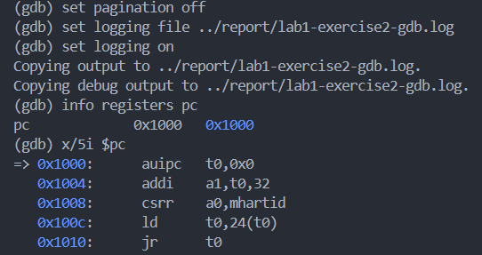
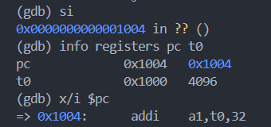
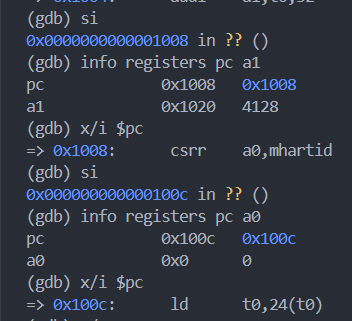
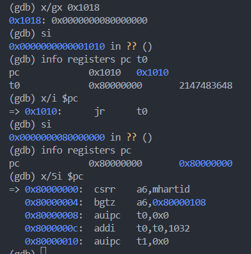
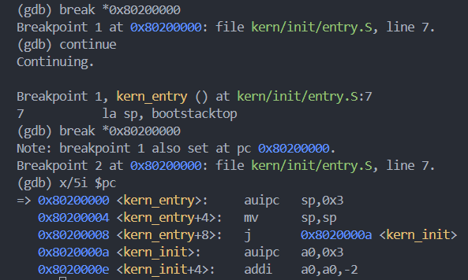
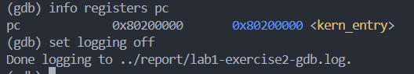
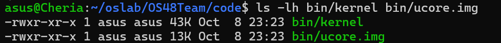
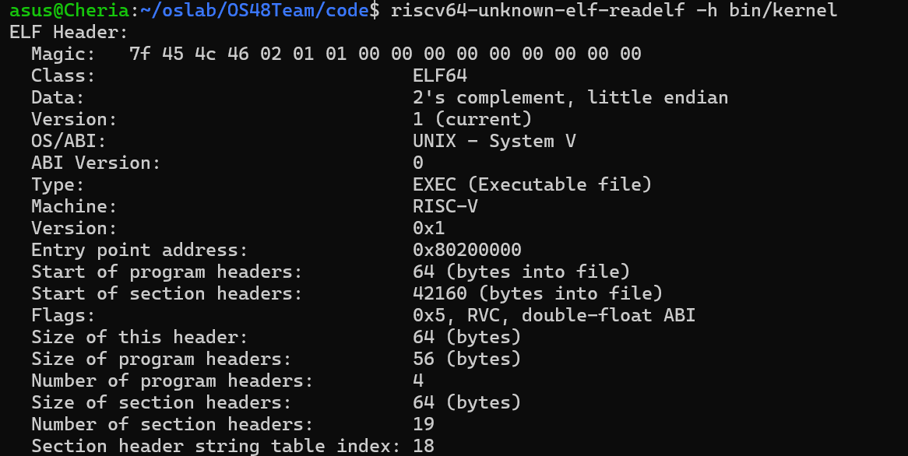
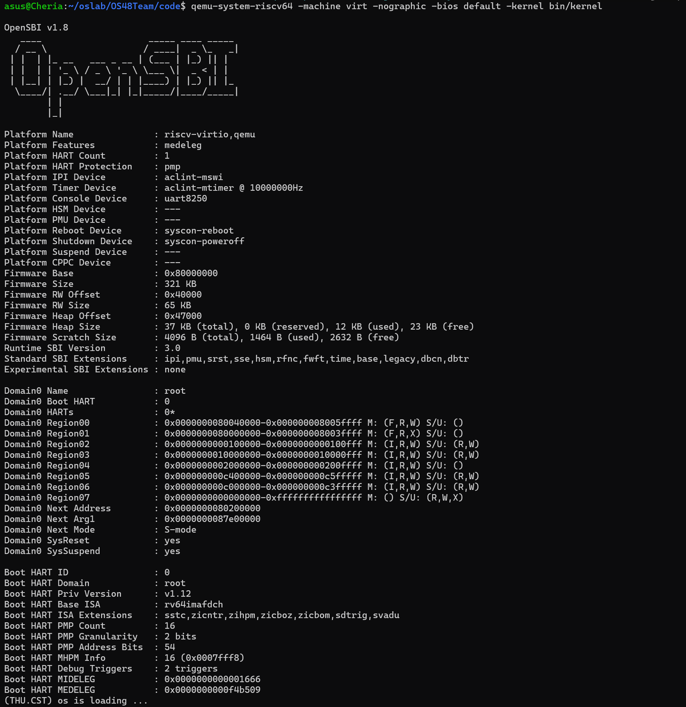

# 操作系统实验报告

## 实验基本信息

| 项目 | 内容 |
|------|------|
| **实验名称** | Lab 1: 比麻雀更小的麻雀（最小可执行内核） |
| **小组成员** | 2413195-钟沁涵、2413467-徐熙凯、2413533-蔡芷涵 |
| **完成日期** | 2026-10-10 |

### 小组分工

练习如何分工？

| 成员 | 负责的练习/模块 |
|------|----------------|
| 学号1-姓名1 |练习1：理解内核启动中的程序入口操作；分析 entry.S 和 init.c  |
| 学号2-姓名2 |练习2：使用 GDB 验证启动流程 |
| 学号3-姓名3 |Makefile、链接脚本及内核整体启动流程分析|

实验报告如何分工？

实验报告按照各成员承担的实验任务进行分工。

成员1负责练习1的汇编入口、内核栈初始化和C语言内核初始化过程分析，并整理相关验证结果；

成员2负责练习2的QEMU与GDB调试过程、运行观察及问题分析；

成员3负责Makefile、链接脚本、整体启动流程和相关操作系统知识点的整理，并承担实验报告的汇总与格式检查。各成员共同参与最终报告的审核与完善。

---

## 一、实验目的

<!-- 说明本次实验的主要目标和预期成果 -->

本实验的主要目的是：

1. 理解 RISC-V 架构下最小可执行内核的启动流程，掌握 QEMU、OpenSBI 与操作系统内核之间的关系，以及从汇编入口进入 C 语言初始化函数的过程。

2. 掌握内核的内存布局和编译链接过程，理解链接脚本、内核入口地址、栈初始化和 BSS 段清零的作用，能够通过交叉编译生成可执行内核镜像。

3. 学习使用 QEMU 模拟运行 RISC-V 内核，并使用 GDB 调试和验证启动过程；理解如何通过 OpenSBI 提供的 SBI 服务实现格式化输出，完成最小可执行内核的运行验证。

---

## 二、实验环境

你们使用的 AI 工具

| 成员 | AI 编程工具 | 底层模型 | 备注 |
|------|------------|---------|------|
| 2413195-钟沁涵 | ChatGPT | GPT-6 | 辅助分析 RISC-V 内核入口、栈初始化及内核启动流程，指导 QEMU/GDB 调试与问题排查 |
| 2413467-徐熙凯 | Codex | GPT-6 | 辅助按指导书搭建与验证 WSL 实验环境，分步指导练习2的 GDB 调试；读取日志核对寄存器和启动地址，并协助整理截图、提示词及报告 |
| 2413533-蔡芷涵 | ChatGPT | GPT-6 | 辅助分析 Makefile、链接脚本和内核整体启动流程；排查并修复 QEMU 启动参数，验证 `make qemu` 输出；协助整理报告内容 |

**说明：**
- **AI 编程工具**：指具体使用的终端工具、编辑器插件、桌面应用或浏览器界面
- **底层模型**：指该工具使用的大语言模型及版本

### 成员2的实验运行环境

**成员：** 2413467-徐熙凯；负责练习2的启动流程调试与验证。

| 项目 | 配置与用途 |
|------|------------|
| 宿主与实验系统 | Windows + WSL2（Ubuntu）；编译、QEMU 和 GDB 均在 WSL Linux 环境中运行 |
| 编辑与终端 | VS Code，通过 WSL 扩展连接 Ubuntu；使用两个集成终端分别运行 QEMU 和 GDB |
| RISC-V 工具链 | SiFive 官方预编译 `riscv64-unknown-elf` 工具链，GCC-Metal `10.2.0-2020.12.8`，GCC 版本 `10.2.0` |
| QEMU | 官方源码编译安装的 `qemu-system-riscv64`，版本 `4.1.1`，模拟 RISC-V 64 位 `virt` 平台 |
| 固件 | QEMU 4.1.1 自带的 OpenSBI `v0.4`，通过 `-bios default` 使用 |
| GDB | 工具链自带的 `riscv64-unknown-elf-gdb`，SiFive GDB-Metal `10.1.0-2020.12.7`，GDB 版本 `10.1` |
| 小组仓库与分支 | `CheriaAshley/OS48Team`；工作分支 `lab1-exercise2`，基于队友的 `lab1` 分支 |
| 实验目录 | Windows：`E:\os_team\OS48Team\code`；WSL：`/mnt/e/os_team/OS48Team/code` |
| 调试方式 | 使用原始 `make debug` 启动 QEMU，再通过 `make gdb` 连接 `localhost:1234`；加载 `bin/kernel` 的符号信息 |
| 调试记录 | GDB 日志 `report/lab1-exercise2-gdb.log`，截图保存在 `report/images/lab1_exercise2_*.png` |

本次环境已完成编译和调试连接验证，并在练习2中实际观察到 `0x1000 → 0x80000000 → 0x80200000` 的启动路径。成员1与成员2使用的固件及启动配置不同，各自的操作和结果分别记录在对应练习中。

---

## 三、实验整体逻辑分析

### 3.1 本章节的逻辑主线

本章围绕 RISC-V 架构下最小可执行操作系统内核的构建与启动展开，核心问题是如何使一个不依赖现有操作系统的内核程序，在 QEMU 模拟的计算机环境中正确加载并运行。

实验首先通过交叉编译和链接脚本，将汇编代码与 C 语言代码组织成具有指定内存布局的内核镜像。随后借助 QEMU 模拟 RISC-V 硬件环境，并利用 OpenSBI 完成底层硬件初始化和向内核的控制权交接。内核启动后，首先通过汇编入口设置栈指针，再进入 C 语言初始化函数，依次完成 BSS 段清零、启动信息输出和循环运行。

整个实验按照“内核代码组织与内存布局 → 编译链接与镜像生成 → QEMU 和 OpenSBI 加载内核 → 汇编入口初始化 → C 语言内核初始化 → 运行调试与验证”的顺序展开。

通过这一过程，逐步理解从硬件启动到操作系统内核开始执行的基本原理，并为后续实现内存管理、异常处理和进程管理等功能建立基础。

### 3.2 功能的逐步实现

1. **首先完成内核代码组织和内存布局设计。** 通过 `tools/kernel.ld` 链接脚本指定内核加载地址为 `0x80200000`，并组织 `.text`、`.rodata`、`.data` 和 `.bss` 等段。这是内核能够正确加载和执行的基础，只有明确各部分代码和数据在内存中的位置，才能保证后续入口跳转与内存访问正确。

2. **接着通过交叉编译和链接生成内核镜像。** 利用 Makefile 调用 RISC-V 交叉编译工具链，将 `entry.S`、`init.c` 及相关基础库编译链接为 ELF 可执行文件，再通过 `objcopy` 生成原始内核镜像。由于宿主机与目标 RISC-V 计算机的指令集不同，需要交叉编译，才能生成适合 QEMU 模拟环境执行的机器指令。

3. **然后通过 QEMU 和 OpenSBI 完成内核加载与启动。** QEMU 模拟 RISC-V 硬件平台，OpenSBI 负责底层初始化，并在启动配置正确的情况下将控制权交给位于 `0x80200000` 的内核入口。内核首先执行 `kern/init/entry.S` 中的 `kern_entry`，使用 `la sp, bootstacktop` 设置启动栈，再通过 `tail kern_init` 跳转到 C 语言初始化函数。之所以先初始化栈，是因为后续 C 函数执行需要有效的栈空间。

4. **最后完成内核初始化、信息输出及运行验证。** `kern_init()` 使用 `memset()` 清零 BSS 段，保证未初始化的全局变量具有正确的初始值；随后通过 `cprintf()` 输出启动信息，并进入 `while(1)` 循环。实验使用 QEMU 验证内核运行结果，并通过 GDB、`readelf` 和 `objdump` 检查入口地址、机器指令及启动过程，从而验证最小内核的构建与执行流程。

---

## 四、实验内容与实现

<!--
说明：本部分按照 exercises 文档中的练习顺序组织
每个功能模块或者练习中可能包含多项任务，请根据实际情况调整
-->

### 功能模块：[模块名称]

**负责人：** [学号-姓名]

#### 模块功能描述

**需要实现/修改的函数：**

```c
// 列出本模块涉及的所有函数签名
void example_function(void);
int another_function(int arg);
```

**功能说明：**

[简要描述该模块的功能，包括：
- 该模块在整个系统中的作用
- 需要处理的主要场景
- 与其他模块的交互关系]

#### 最终提示词

以下是经过迭代优化后，最终成功实现该功能的提示词：

````markdown

[按照提示词模板，给出具体的提示词]

````

#### 实现迭代过程

本模块的实现经历了 [N] 次迭代，过程如下：

---

##### 第一次迭代

如果设计的prompt生成代码后出现问题：

**遇到的问题：**
- 问题1：问题描述、错误信息和原因分析
- 问题2：问题描述、错误信息和原因分析

**问题解决策略：**
- 针对问题1：[说明如何修改提示词]
- 针对问题2：[说明如何修改提示词]

如果没有问题：

**最终结果：**

经过 [N] 次迭代，该模块最终：
- ✅ 编译通过
- ✅ 所有相关测试通过
- ✅ 功能符合预期

**关键改进点总结（如有）：**
1. [改进点1：例如，在 [RELY] 中补充了完整的系统调用号定义]
2. [改进点2：例如，在 [SPECIFICATION] 中明确了异常处理的边界条件]
3. [改进点3：例如，增加了对用户指针合法性检查的要求]

---

### 练习1：理解内核启动中的程序入口操作

**负责人：** [2413195-钟沁涵]

1. 实验任务

阅读 kern/init/entry.S 中的汇编代码，结合 RISC-V 操作系统内核启动流程，分析 la sp, bootstacktop 和 tail kern_init 两条指令完成的操作及其目的，并结合 kern/init/init.c 理解内核初始化过程。

2. 内核入口代码分析

内核入口位于 kern/init/entry.S，关键代码如下：

.section .text,"ax",%progbits
.globl kern_entry
kern_entry:
    la sp, bootstacktop
    tail kern_init

kern_entry 是内核汇编入口。在 OpenSBI 完成底层初始化并将控制权交给内核后，CPU 从该位置开始执行。入口代码首先初始化栈指针，然后跳转到 C 语言编写的内核初始化函数。

（1）la sp, bootstacktop 的作用及目的

la 是 RISC-V 汇编中的地址加载伪指令，sp 是栈指针寄存器，bootstacktop 是启动栈顶部的地址标签。

该指令将 bootstacktop 对应的地址加载到 sp 中，使栈指针指向预留的内核启动栈顶部。

启动栈在 entry.S 中定义：

.section .data
    .align PGSHIFT
    .global bootstack
bootstack:
    .space KSTACKSIZE
    .global bootstacktop
bootstacktop:

其中，.align PGSHIFT 用于地址对齐，.space KSTACKSIZE 用于预留内核栈空间，bootstack 和 bootstacktop 分别标记栈空间的起始位置和顶部位置。

由于 RISC-V 的栈通常向低地址增长，因此内核将初始栈指针设置在栈空间顶部。

这样做的目的是为后续 C 函数调用、局部变量保存和寄存器保护提供有效的栈空间，避免内核在没有正确初始化栈指针的情况下访问错误的内存地址。

（2）tail kern_init 的作用及目的

tail 是 RISC-V 的尾调用伪指令，用于将程序执行流程直接转移到目标函数，而不为此次跳转设置新的返回地址。

因此，tail kern_init 的作用是使 CPU 从汇编入口跳转到 C 语言函数 kern_init()，开始执行内核初始化程序。

由于 kern_entry 的主要任务只是建立内核的基本执行环境，完成栈初始化后便不再需要返回，因此采用尾调用方式进入 kern_init()。

该指令实现了从汇编启动代码到 C 语言内核代码的衔接。

3. 内核初始化过程分析

在 kern/init/init.c 中，kern_init() 的主要执行过程如下：

int kern_init(void) {
    extern char edata[], end[];
    memset(edata, 0, end - edata);

    const char *message = "(THU.CST) os is loading ...\n";
    cprintf("%s\n\n", message);

    while (1)
        ;
}

首先，memset(edata, 0, end - edata) 将指定的 BSS 内存区域清零，保证未初始化的全局变量和静态变量具有正确的初始状态。

随后，cprintf() 通过内核提供的输出接口，最终借助 SBI 控制台服务输出内核启动信息。

最后，程序进入 while(1) 无限循环。由于当前实验仅构建最小可执行内核，尚未实现进程调度等后续功能，因此通过死循环保持内核运行，避免初始化函数意外返回。

4. 实验验证与结果分析

（1）内核入口地址验证

通过以下命令查看 ELF 文件的入口信息：

riscv64-unknown-elf-readelf -h bin/kernel

实验结果显示：

Entry point address: 0x80200000

说明链接后的内核入口地址符合指导书要求。

（2）汇编指令验证

通过以下命令查看内核反汇编结果：

riscv64-unknown-elf-objdump -d bin/kernel | head -40

关键结果如下：

80200000: auipc sp,0x3
80200004: mv    sp,sp
80200008: j     8020000a <kern_init>

可以观察到，地址加载伪指令被转换为实际机器指令，而 tail kern_init 最终被优化为跳转指令，说明内核入口代码已正确编译和链接。

（3）内核运行验证

实验最初使用指导书提供的 make qemu 命令启动 QEMU，OpenSBI 能正常运行，但未能输出内核启动信息。

进一步检查发现，原始启动方式下 OpenSBI 输出的下一阶段入口地址为 0x0，没有正确进入内核。

随后使用以下命令进行对照验证：

qemu-system-riscv64 -machine virt -nographic -bios default -kernel bin/kernel

运行结果显示：

Domain0 Next Address : 0x0000000080200000

(THU.CST) os is loading ...

说明在该启动方式下，OpenSBI 正确获得内核入口地址，CPU 成功进入内核并执行到 cprintf() 输出语句。

这也表明，操作系统能否正常启动不仅与内核代码本身有关，还取决于固件与内核之间的加载和控制权交接方式。


---

### 练习2：使用 GDB 验证启动流程

**负责人：** [2413467-徐熙凯]

1. 实验任务

使用 GDB 跟踪 QEMU 模拟的 RISC-V 从加电开始，到进入内核第一条指令（地址 `0x80200000`）的过程。通过观察程序计数器、寄存器、内存和反汇编结果，回答最初几条指令的位置及其主要功能，并验证固件向内核移交控制权的过程。

本练习在练习1已有代码的基础上完成，使用 `lab1-exercise2` 分支，不需要修改内核源码。任务要求参考[实验指导书：练习2](http://oslab.mobisys.top/lab2026/_book/lab1/lab1_2_1_exercise.html)。

2. 调试环境与启动方法

本次使用 Windows 上的 VS Code 远程连接 WSL Ubuntu，在 WSL 终端中运行交叉编译工具、QEMU 和 GDB。QEMU 版本为 `4.1.1`，工具链为 SiFive `riscv64-unknown-elf` GCC `10.2.0`，GDB 为 SiFive GDB-Metal `10.1`。本次环境能够使用项目原始 Makefile 中的 `-device loader` 启动方式，不需要使用练习1中的 `-kernel` 对照命令。

在终端A中执行：

```bash
source ~/.bashrc
cd /mnt/e/os_team/OS48Team/code
make debug
```

Makefile 使用 `-s -S` 启动 QEMU。其中，`-s` 开启 TCP 1234 端口上的 GDB 调试服务，`-S` 使 CPU 在启动时暂停，等待调试器控制。因此，`make debug` 完成编译后没有继续输出，是暂停等待调试的正常表现。

保持终端A运行，在终端B的相同目录执行：

```bash
source ~/.bashrc
cd /mnt/e/os_team/OS48Team/code
make gdb
```

GDB 加载 `bin/kernel` 的符号信息，设置目标架构为 `riscv:rv64`，并连接 `localhost:1234`。连接成功后，初始位置为 `0x0000000000001000 in ?? ()`。这里的 `??` 表示当前加载的内核符号无法标识该地址处的函数，不代表调试失败。

为保存实际调试输出，在 GDB 中执行：

```gdb
set pagination off
set logging file ../report/lab1-exercise2-gdb.log
set logging on
```

完整输出保存在 [GDB 调试日志](./lab1-exercise2-gdb.log)。

3. 调试过程与观察结果

（1）观察加电后最初的执行地址和指令

在 CPU 尚未继续运行时，执行：

```gdb
info registers pc
x/5i $pc
```

实际结果如下：

```text
pc             0x1000   0x1000
=> 0x1000: auipc t0,0x0
   0x1004: addi  a1,t0,32
   0x1008: csrr  a0,mhartid
   0x100c: ld    t0,24(t0)
   0x1010: jr    t0
```

这说明在本实验的 QEMU `virt` 环境中，CPU 最初执行的是位于 `0x1000` 的复位启动代码，而不是直接执行 `0x80200000` 处的内核代码。



（2）单步观察启动参数的准备过程

首先执行第一条指令，并查看寄存器：

```gdb
si
info registers pc t0
x/i $pc
```

执行 `auipc t0,0x0` 后，`pc` 变为 `0x1004`，`t0` 为 `0x1000`。该指令将自身的 PC 与立即数对应的偏移相加，偏移为零，因此 `t0` 保存了复位代码的起始地址。



随后依次执行：

```gdb
si
info registers pc a1
x/i $pc
si
info registers pc a0
x/i $pc
```

执行 `addi a1,t0,32` 后，`a1 = 0x1020`，`pc = 0x1008`；执行 `csrr a0,mhartid` 后，`a0 = 0`，`pc = 0x100c`。前者设置传给固件的地址参数，后者读取当前硬件线程的编号。本次启动线程的编号为0。

结合 [QEMU 4.1.1 的 virt 平台源码](https://github.com/qemu/qemu/blob/v4.1.1/hw/riscv/virt.c#L393)，复位向量后紧接着放置设备树，`0x1020` 是该版本传给固件的设备树地址。因此，寄存器观测得到的数值与平台源码的布局相符。



（3）读取固件入口地址并跳转到 OpenSBI

当前 `t0 = 0x1000`，因此 `ld t0,24(t0)` 读取的内存地址为 `0x1018`。先检查该地址，再单步执行：

```gdb
x/gx 0x1018
si
info registers pc t0
x/i $pc
```

实际结果如下：

```text
0x1018:        0x0000000080000000
pc             0x1010   0x1010
t0             0x80000000
=> 0x1010:     jr t0
```

这里 `x/gx` 按8字节、十六进制格式查看内存，观察到保存的固件入口地址为 `0x80000000`。执行 `ld` 后，该地址进入 `t0`。

接着执行：

```gdb
si
info registers pc
x/5i $pc
```

执行 `jr t0` 后，观察到：

```text
pc             0x80000000   0x80000000
=> 0x80000000: csrr  a6,mhartid
   0x80000004: bgtz  a6,0x80000108
   0x80000008: auipc t0,0x0
   0x8000000c: addi  t0,t0,1032
   0x80000010: auipc t1,0x0
```

这验证了 CPU 从复位代码跳转到 OpenSBI 的入口。需要区分：`0x1000` 是 QEMU 提供的复位跳转代码，`0x80000000` 才是本次 OpenSBI 固件的入口。



（4）设置断点，验证进入内核入口

为了避免逐条跟踪固件中的大量指令，在内核入口设置断点，然后继续运行：

```gdb
break *0x80200000
continue
```

实际命中结果如下：

```text
Breakpoint 1, kern_entry () at kern/init/entry.S:7
7       la sp, bootstacktop
```

随后执行 `x/5i $pc`，得到：

```asm
=> 0x80200000 <kern_entry>:   auipc sp,0x3
   0x80200004 <kern_entry+4>: mv    sp,sp
   0x80200008 <kern_entry+8>: j     0x8020000a <kern_init>
   0x8020000a <kern_init>:    auipc a0,0x3
   0x8020000e <kern_init+4>:  addi  a0,a0,-2
```

GDB 将当前地址对应到 `entry.S` 第7行，表明执行流程已经到达内核汇编入口。源码中的 `la sp, bootstacktop` 是伪指令，在本次编译结果中对应 `auipc sp,0x3` 和 `mv sp,sp`；后面的跳转进入 `kern_init`，与练习1的分析一致。此时停在内核第一条机器指令执行之前，尚未通过单步操作执行内核栈初始化。

截图中还出现了在相同地址重复设置的断点2，这是命中断点后重复输入 `break *0x80200000` 造成的，不影响本次验证结果。



最后补充检查程序计数器并关闭日志：

```gdb
info registers pc
set logging off
```

结果为 `pc = 0x80200000 <kern_entry>`，进一步确认 CPU 已到达要求的内核入口位置。



4. 问题回答与结果分析

（1）RISC-V 硬件加电后最初执行的几条指令位于什么地址？

在本实验所使用的 QEMU 4.1.1 `virt` 模拟平台中，CPU 复位后的初始 PC 为 `0x1000`。最初五条指令分别位于 `0x1000`、`0x1004`、`0x1008`、`0x100c` 和 `0x1010`。该地址是本实验平台的配置，不能据此认为所有 RISC-V 硬件的复位地址都相同。

（2）这些指令主要完成了哪些功能？

| 指令地址 | 指令 | 主要功能及实际观察 |
|----------|------|--------------------|
| `0x1000` | `auipc t0,0x0` | 保存复位代码的基地址，执行后 `t0 = 0x1000` |
| `0x1004` | `addi a1,t0,32` | 准备设备树地址参数，执行后 `a1 = 0x1020` |
| `0x1008` | `csrr a0,mhartid` | 读取硬件线程编号，执行后 `a0 = 0` |
| `0x100c` | `ld t0,24(t0)` | 从 `0x1018` 读取固件入口地址，执行后 `t0 = 0x80000000` |
| `0x1010` | `jr t0` | 跳转到固件入口，执行后 `pc = 0x80000000` |

因此，最初几条指令的主要作用是准备固件启动所需的参数，并将控制权交给 OpenSBI。后续由 OpenSBI 完成初始化并转入内核。本次实际观察到的启动路径为：

```text
0x1000：复位启动代码
    ↓ 准备参数，读取入口并跳转
0x80000000：OpenSBI 固件入口
    ↓ 固件初始化并移交控制权
0x80200000：内核入口 kern_entry
```

本次 Makefile 通过 QEMU 的 `-device loader,file=bin/ucore.img,addr=0x80200000` 参数装入内核镜像，应区分镜像加载和 CPU 跳转执行两个过程。入口断点验证的是 CPU 实际到达内核，不应将命中断点描述为刚刚发生了内核镜像加载，也不能根据此次跟踪宣称已经验证了内核全部初始化和输出操作。

5. 调试中的问题与 AI 协作记录

最初连接 GDB 时曾出现数据包错误和 `vMustReplyEmpty: timeout`，此时不能认定远程连接成功。调试期间还曾尝试在浏览器中打开 `localhost:1234`，但该端口提供的是 GDB 远程协议服务，不是 HTTP 网页。关闭浏览器访问、退出原有 GDB 和 QEMU 会话，再依次运行 `make debug`、`make gdb` 后，连接成功并停在 `0x1000`。由于没有对连接异常进行完整的协议抓包，不能把浏览器访问断定为唯一故障原因。

本次采用 AI 分步指导、成员在 WSL 终端实际操作的方式：AI 解释每条命令的目的和预期结果，成员执行后保存截图，AI 再读取实际 GDB 日志核对寄存器和跳转地址。提示词按标准四段式整理在 [prompt.md 的练习2部分](./prompt.md#练习2使用-gdb-验证启动流程成员2)，其中的回答摘要与验证结果以本次对话、截图和日志为依据。

本练习完成了复位地址确认、最初五条指令单步分析、OpenSBI 入口跳转验证和内核入口断点验证，无需修改内核代码。

---

### 补充分析：Makefile、链接脚本与内核启动流程

**负责人：** [2413533-蔡芷涵]

#### 1. 模块功能描述

本模块主要分析最小可执行内核从编译、链接到 QEMU 启动的完整流程，并检查 Makefile、链接脚本以及内核启动代码之间的配合关系。通过本模块，可以理解内核镜像如何生成、如何被加载到指定地址，以及处理器如何从 OpenSBI 进入内核入口并执行 C 语言初始化代码。

#### 2. Makefile 与内核镜像生成

Makefile 使用 RISC-V 交叉编译工具链，将汇编代码、C 语言源代码和基础库编译为适用于 RISC-V 64 位平台的目标文件，然后通过链接器生成 `bin/kernel`，再使用 `objcopy` 生成内核镜像 `bin/ucore.img`。

主要流程如下：

```text
entry.S、init.c 及基础库源文件
        |
        v
RISC-V 交叉编译
        |
        v
目标文件
        |
        v
链接器根据 tools/kernel.ld 生成 bin/kernel
        |
        v
objcopy 生成 bin/ucore.img
        |
        v
QEMU 加载并运行内核
```

在实际验证过程中，原有 QEMU 启动参数与当前内核镜像的加载方式不完全匹配，导致执行 `make qemu` 时 OpenSBI 虽然能够启动，但没有按照预期进入内核。检查内核链接地址和 QEMU 启动参数后，对 Makefile 中的启动配置进行了修正，使 QEMU 能够按照正确的方式加载内核镜像。

修复后执行：

```bash
cd ~/OS48Team/code
make clean
make
make qemu
```

终端成功输出：

```text
(THU.CST) os is loading ...
```

说明内核已经完成编译和链接，QEMU 成功加载内核，并执行到了 `kern_init()`。

#### 3. 链接脚本分析

链接脚本位于 `tools/kernel.ld`，其中的关键配置如下：

```ld
ENTRY(kern_entry)

BASE_ADDRESS = 0x80200000;
```

`ENTRY(kern_entry)` 指定内核的入口符号为 `kern_entry`。`BASE_ADDRESS = 0x80200000` 指定内核的链接基地址，因此内核入口地址为：

```text
0x80200000
```

链接脚本按照内核运行需要组织不同的段：

```text
.text       保存可执行代码
.rodata     保存只读数据
.data       保存已初始化的可写数据
.bss        保存未初始化的全局变量和静态变量
```

链接脚本还定义了 `edata` 和 `end` 两个符号：

```ld
PROVIDE(edata = .);

.bss : {
    *(.bss)
    *(.bss.*)
    *(.sbss*)
}

PROVIDE(end = .);
```

`edata` 表示已初始化数据区域的结束位置，`end` 表示 BSS 区域结束位置。内核启动时使用这两个符号确定需要清零的内存范围。

#### 4. 内核整体启动流程

内核启动流程可以概括为：

```text
QEMU 复位代码
    |
    v
OpenSBI 固件
    |
    v
kern_entry
    |
    v
设置启动栈 sp
    |
    v
kern_init()
    |
    v
清零 BSS 区域
    |
    v
输出启动信息
    |
    v
while (1) 保持运行
```

在 `kern/init/entry.S` 中，内核入口代码如下：

```asm
kern_entry:
    la sp, bootstacktop
    tail kern_init
```

`la sp, bootstacktop` 将启动栈顶地址加载到栈指针寄存器 `sp`。启动栈由 `bootstack` 和 `bootstacktop` 两个符号标记，并通过 `.space KSTACKSIZE` 预留空间。由于 RISC-V 栈通常向低地址方向增长，因此初始栈指针应设置在启动栈顶。

`tail kern_init` 将程序控制流直接转移到 C 语言函数 `kern_init()`。该指令不保存新的返回地址，因为内核初始化函数不会返回，符合最小内核启动阶段的执行逻辑。

在 `kern/init/init.c` 中，`kern_init()` 的主要代码如下：

```c
extern char edata[], end[];
memset(edata, 0, end - edata);

const char *message = "(THU.CST) os is loading ...\n";
cprintf("%s\n\n", message);

while (1)
    ;
```

首先，`memset(edata, 0, end - edata)` 将 BSS 区域清零，使未显式初始化的全局变量和静态变量符合 C 语言规定的初始值。

然后，`cprintf()` 输出内核启动信息。由于当前实验只实现了最小内核，因此函数最后进入无限循环，防止初始化函数返回到不存在的调用者。

#### 5. 内核输出调用链

启动信息的输出调用链如下：

```text
cprintf()
    -> vcprintf()
    -> vprintfmt()
    -> cputch()
    -> cons_putc()
    -> sbi_console_putchar()
    -> sbi_call()
    -> ecall
    -> OpenSBI
    -> QEMU 虚拟串口
```

`cprintf()` 负责处理格式字符串和可变参数。随后 `vcprintf()` 将 `cputch` 作为单字符输出函数传递给 `vprintfmt()`。`vprintfmt()` 解析格式字符串，并逐个输出字符。

`cputch()` 调用 `cons_putc()`，`cons_putc()` 再调用 `sbi_console_putchar()`。后者通过 `sbi_call()` 设置 SBI 调用号和字符参数，并执行 RISC-V 的 `ecall` 指令。

执行 `ecall` 后，处理器进入 OpenSBI。OpenSBI 处理控制台输出请求，并将字符发送到 QEMU 的虚拟串口，最终在终端显示：

```text
(THU.CST) os is loading ...
```

这说明从 C 语言格式化输出、内核控制台、SBI 接口到 QEMU 虚拟串口的完整输出链路均正常工作。

#### 6. 实验结果

本模块完成了以下验证：

1. 确认链接脚本将内核入口地址设置为 `0x80200000`。
2. 确认 Makefile 能够调用 RISC-V 交叉编译工具链生成内核文件。
3. 修正 QEMU 启动参数，使 `make qemu` 能够正常启动内核。
4. 验证 `entry.S` 能够设置启动栈并跳转到 `kern_init()`。
5. 验证 `kern_init()` 能够清零 BSS 区域并输出启动信息。
6. 验证启动信息能够通过 SBI 和 OpenSBI 输出到 QEMU 终端。

最终，内核能够成功编译、加载并运行，终端输出：

```text
(THU.CST) os is loading ...
```


---

## 五、测试与验证

<!-- 根据该实验的具体情况，提供完整的测试运行截图，应包含：
- 编译及运行成功的输出（make qemu），可能有多个
- 测试通过的结果（make grade），只有一个
-->

**测试截图：**

**1. 内核编译与镜像生成**

执行 `make qemu` 后，`entry.S`、`init.c` 及相关基础库成功编译，生成 `bin/kernel` 和 `bin/ucore.img`，说明内核代码能够正常编译和链接。



**2. 内核入口地址验证**

通过 `riscv64-unknown-elf-readelf -h bin/kernel` 检查 ELF 文件，确认内核入口地址为 `0x80200000`，符合实验指导书要求。



**3. QEMU 内核启动验证**

使用原始 `make qemu` 命令时，OpenSBI 能够正常启动，但未能进入内核输出阶段。经检查，原始启动方式下 OpenSBI 显示的下一阶段入口地址为 `0x0`。

随后采用以下命令进行对照验证：

```bash
qemu-system-riscv64 -machine virt -nographic -bios default -kernel bin/kernel
```

运行结果显示 OpenSBI 的下一阶段入口地址为 `0x80200000`，并成功输出：

```text
(THU.CST) os is loading ...
```

说明在该启动配置下，最小内核能够正确加载并执行，完成 BSS 段初始化和启动信息输出。




---

**4. 练习2：启动流程的 GDB 验证**

本次在 QEMU 4.1.1 环境中使用原始 `make debug` 和 `make gdb` 完成验证。通过单步操作确认初始 PC 为 `0x1000`，读取固件入口地址后跳转到 `0x80000000`，继续执行命中 `0x80200000` 的 `kern_entry` 断点。

六张调试截图、对应命令和结果分析见“练习2：使用 GDB 验证启动流程”；完整输出见 [GDB 调试日志](./lab1-exercise2-gdb.log)。这组证据验证了 CPU 到达内核入口，不将尚未执行的内核初始化过程记为本次验证结果。

---

## 六、实验总结与收获

### 对操作系统的理解

**1. 本实验的重要知识点及其与 OS 原理的联系**

（1）内核启动与操作系统初始化

实验知识点：通过 QEMU 模拟 RISC-V 硬件，由 OpenSBI 完成底层初始化，再将控制权交给内核入口 `kern_entry`，最终执行 `kern_init()`。

对应 OS 原理：操作系统启动与内核初始化机制。

联系与差异：两者都涉及从底层硬件环境到操作系统内核的控制权交接。OS 原理主要介绍启动过程和基本机制，本实验则通过具体的汇编入口、内核函数和启动地址展示了这一过程。

（2）内存布局与内存管理

实验知识点：通过链接脚本组织 `.text`、`.rodata`、`.data` 和 `.bss` 等段，使用 `memset()` 清零 BSS 段，并通过 `bootstack` 为内核预留启动栈空间。

对应 OS 原理：内存空间的组织与管理。

联系与差异：两者都需要合理组织和使用内存。OS 原理中的内存管理还包括虚拟内存、地址映射和内存分配等内容，而本实验仅实现了内核启动阶段的静态内存布局和基本初始化，尚未涉及完整的内存管理机制。

（3）栈与函数调用机制

实验知识点：通过 `la sp, bootstacktop` 初始化栈指针，并使用 `tail kern_init` 从汇编入口跳转到 C 语言函数。

对应 OS 原理：程序执行环境、函数调用和运行时栈。

联系与差异：两者都涉及程序执行时对栈空间的使用。本实验重点关注操作系统启动时如何建立最初的栈环境，而 OS 原理还涉及进程栈、内核栈以及上下文切换等更复杂的机制。

（4）特权级与软硬件接口

实验知识点：OpenSBI 运行在 RISC-V 的 M 模式，实验内核运行在 S 模式，并通过 SBI 接口获得底层控制台输出服务。

对应 OS 原理：处理器特权级、系统软件分层及软硬件交互机制。

联系与差异：两者都通过权限划分和接口设计实现不同层次的软件协作。需要注意，SBI 是操作系统内核与更底层固件之间的接口，不同于用户程序通过系统调用访问操作系统内核。

**2. OS 原理中重要但本实验尚未涉及的知识点**

（1）进程与线程管理：包括进程创建、状态转换、上下文切换和 CPU 调度。本实验只有单一的内核执行流程，尚未实现多任务运行。

（2）虚拟内存管理：包括页表、地址转换、缺页异常和页面分配。本实验主要使用预先确定的物理内存布局，尚未建立完整的虚拟内存机制。

（3）中断与异常处理：包括中断响应、异常处理程序及中断返回机制。本实验主要关注启动流程，尚未实现完整的内核中断与异常处理功能。

（4）文件系统与设备管理：包括文件组织、磁盘访问、设备驱动和 I/O 管理。本实验仅通过 SBI 实现基本字符输出，尚未涉及完整的文件系统和设备管理机制。

这些知识点是现代操作系统实现资源管理和多任务运行的重要基础，也是后续实验需要逐步完善的功能。

### AI 协作开发的经验

本次实验主要使用 ChatGPT 辅助理解实验指导书、分析内核源码、解释 RISC-V 汇编指令，并协助排查 QEMU 启动过程中遇到的问题。

在实验初期，通过分析 `entry.S` 和 `init.c`，逐步理解了内核启动栈的初始化、汇编与 C 语言之间的衔接以及 BSS 段清零等操作。相比直接阅读代码，结合 AI 对具体指令进行解释，有助于理解每条指令在整个启动流程中的作用。

在运行验证过程中，最初使用 `make qemu` 时，虽然 OpenSBI 能够启动，但没有出现预期的内核输出信息。随后借助 AI 提供的排查思路，使用 `readelf` 检查 ELF 入口地址，使用 `objdump` 分析机器指令，并通过 GDB 观察 CPU 的执行状态。最终通过对照不同 QEMU 启动参数，发现使用 `-kernel bin/kernel` 时能够正确进入内核，并成功输出启动信息。

这一过程使我们认识到，编译成功并不意味着程序一定能够正常运行，还需要结合实际运行结果进行验证。同时，AI 提供的分析和建议也不能直接作为最终结论，必须通过终端输出、寄存器状态和实际执行结果加以确认。

通过本次实验，我们体会到 AI 更适合作为辅助学习和问题分析的工具。将 AI 的解释与源码阅读、实际调试相结合，既能够提高理解和排查问题的效率，也有助于培养独立分析和验证实验结果的能力。

---

