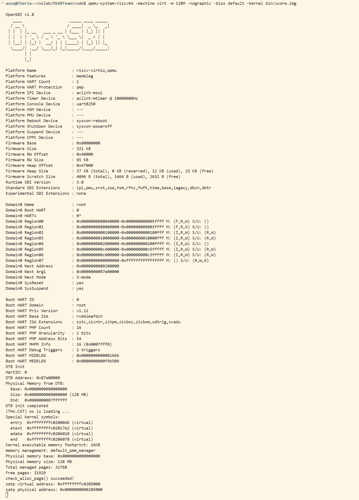
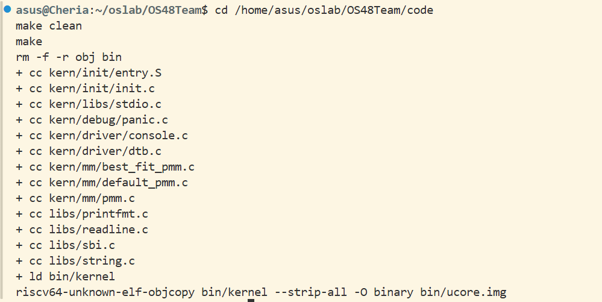
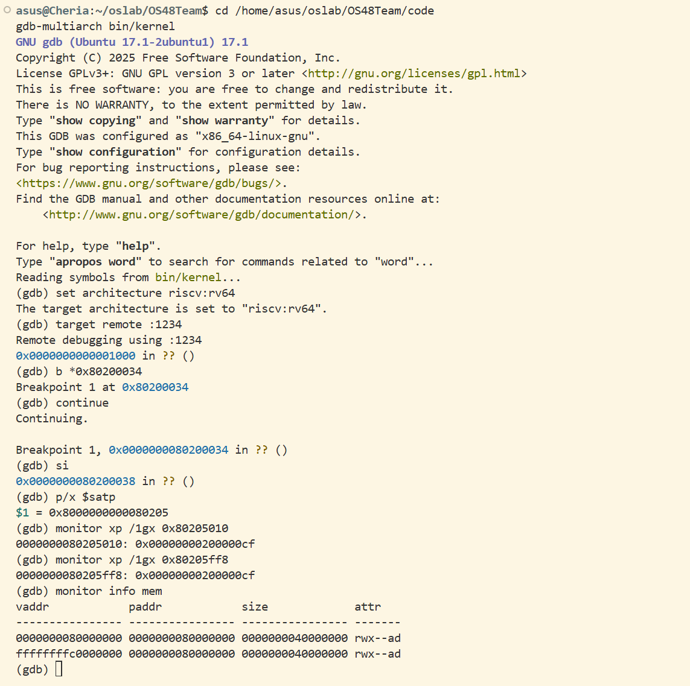
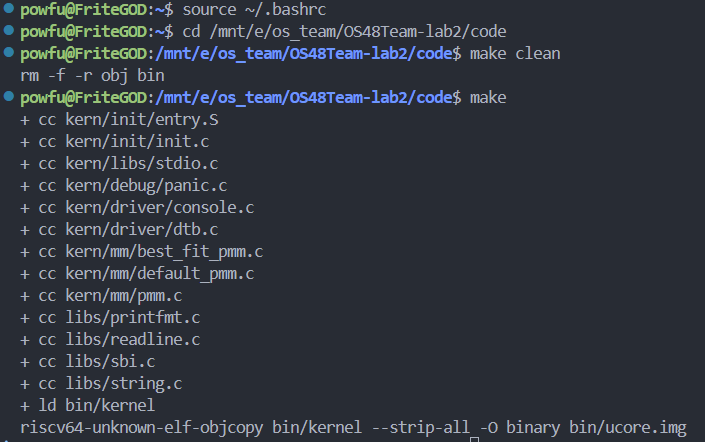
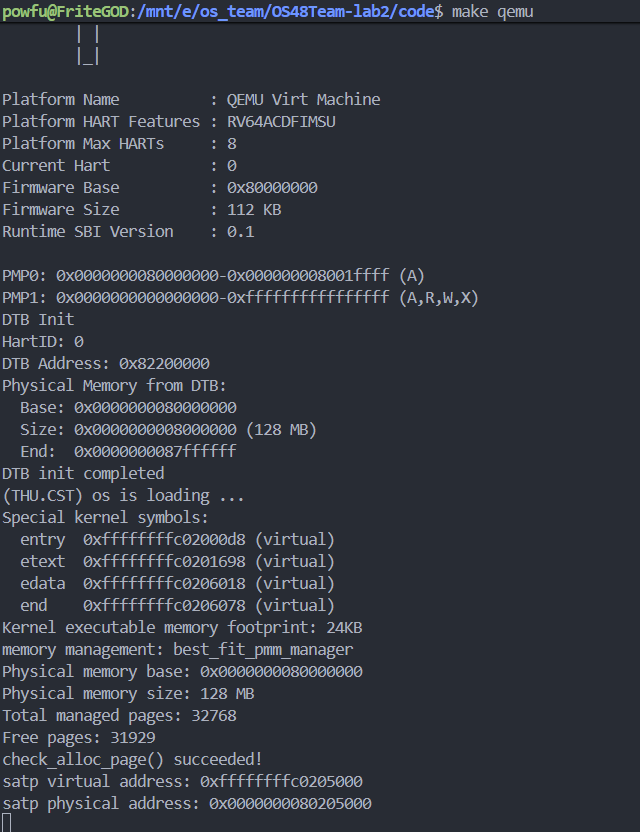
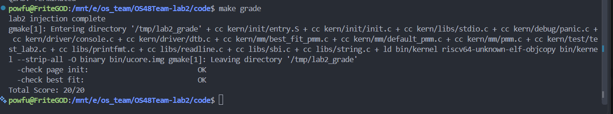
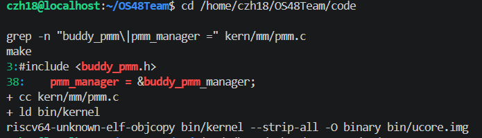
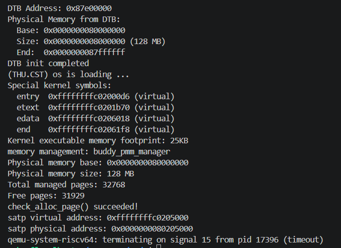

# 操作系统实验报告

## 实验基本信息

| 项目 | 内容 |
|---|---|
| **实验名称** | Lab2：物理内存管理 |
| **小组成员** | 钟沁涵（2413195）、徐熙凯（2413467）、蔡芷涵（2413533） |
| **完成日期** | 2026-10-24 |

### 小组分工

| 成员 | 负责的练习/模块 |
|---|---|
| 钟沁涵（2413195） | 物理内存初始化 `page_init()`、设备树内存探测、Sv39 启动页表修复、GDB 页表调试与地址映射验证 |
| 徐熙凯（2413467） | First-Fit 算法分析、Best-Fit 连续物理内存分配算法的实现与测试、最终代码整合 |
| 蔡芷涵（2413533） | Buddy System 伙伴系统分配算法的实现、测试设计及算法对比分析 |

**实验报告分工：**

本次实验报告由小组三名成员共同完成，各成员分别负责自己承担的功能模块，包括原理分析、核心函数说明、代码实现、测试验证及问题分析。实验整体目标、实现流程和总结部分在各成员工作成果的基础上统一整理。

---

## 一、实验目的

本次 Lab2 实验围绕操作系统的物理内存管理展开。在 Lab1 实现最小可执行内核的基础上，进一步建立物理内存管理机制，使操作系统能够识别、组织、分配和回收物理内存资源，并初步理解页表管理及虚拟地址与物理地址之间的映射关系。

本次实验的主要目的包括：

1. **理解物理内存管理的基本原理。** 掌握物理地址、虚拟地址、物理页、页描述符以及连续物理内存分配等基本概念，理解操作系统管理物理内存的必要性。

2. **掌握物理内存探测与初始化方法。** 通过 RISC-V 设备树（DTB）获取物理内存范围，建立 `struct Page` 页描述符数组，识别并初始化可用物理页，为后续内存分配算法提供基础。

3. **理解并分析 First-Fit 分配算法。** 通过阅读 `default_pmm.c` 中的相关函数，掌握空闲链表的组织方式，以及连续物理页的分配、释放和合并过程。

4. **实现 Best-Fit 连续物理内存分配算法。** 在已有物理内存管理框架的基础上，实现选择满足需求的最小空闲块的分配策略，并通过测试验证其正确性。

5. **理解并实现 Buddy System 伙伴系统分配算法。** 掌握按 2 的幂次划分空闲内存块、分裂较大内存块和合并空闲伙伴块的方法，进一步理解不同内存分配策略的特点。

6. **理解 RISC-V Sv39 分页机制。** 掌握页表项、页表基址寄存器 `satp` 及地址映射的基本原理，了解虚拟地址到物理地址的转换过程。

7. **掌握操作系统内核的调试与测试方法。** 使用 QEMU 模拟器、GDB 调试器及实验测试函数验证各模块的运行情况，能够分析内核启动异常、页表映射问题及物理内存管理中的潜在错误。

8. **学习 AI 辅助操作系统实验的方法。** 在理解代码结构与功能要求的基础上，使用 AI 工具辅助分析实现思路、编写代码和定位错误，并通过编译、运行与测试验证生成结果。

本次实验的预期成果是建立基本的物理内存管理机制，完成物理页初始化以及不同连续物理内存分配算法的实现与验证，使内核能够正确识别、组织并管理可用物理内存，为后续操作系统实验奠定基础。

---

## 二、实验环境

本实验由三名小组成员协作完成，以下按成员分别记录实际实验环境。

### 2.1 开发与运行环境

#### 成员一：钟沁涵（2413195）

| 项目 | 实验环境 |
|---|---|
| 宿主操作系统 | Windows |
| Linux 实验环境 | WSL2 Ubuntu |
| 代码编辑器 | Visual Studio Code（Remote WSL） |
| 实验项目 | riscv64-ucore |
| 目标指令集架构 | RISC-V 64 位 |
| 交叉编译工具链 | riscv64-unknown-elf-gcc |
| 模拟运行环境 | QEMU 10.2.1 |
| 启动固件 | OpenSBI 1.8 |
| 调试工具 | GDB Multiarch 17.1 |
| 版本管理工具 | Git + GitHub |
| Git 实验分支 | lab2 |
| 代码存放路径 | `/home/asus/oslab/OS48Team/code` |

成员一使用 Windows 作为宿主操作系统，在 WSL2 Ubuntu 中进行实际开发，通过 Visual Studio Code 连接 WSL 环境编辑内核代码。

使用 RISC-V 交叉编译工具链生成内核镜像，通过 QEMU 模拟 64 位 RISC-V 计算机，并使用 GDB 对内核入口、Sv39 页表及物理内存初始化流程进行调试。

实验代码通过 Git 进行版本管理，并在 GitHub 的 `lab2` 分支中进行同步。

#### 成员二：徐熙凯（2413467）

| 项目 | 实验环境 |
|---|---|
| 宿主操作系统 | Windows |
| Linux 实验环境 | WSL2，Ubuntu 26.04.1 LTS，x86_64 |
| 代码编辑器 | Visual Studio Code（Remote WSL） |
| 目标架构 | RISC-V 64 位，ucore |
| 交叉编译工具链 | SiFive GCC-Metal 10.2.0-2020.12.8 |
| 模拟运行环境 | QEMU 4.1.1（指导书示例版本） |
| 启动固件 | QEMU 随附 OpenSBI v0.4，`-bios default` |
| 调试工具 | SiFive GDB-Metal 10.1.0-2020.12.7 |
| 版本管理工具 | Git + GitHub |
| Git 实验分支 | `lab2` |
| 代码存放路径 | `/mnt/e/os_team/OS48Team-lab2/code` |

成员二保留指导书对应的本机工具环境，在队友的 `lab2` 分支基础上完成
First-Fit 分析及 Best-Fit 实现。原 Lab1 目录另行保留。

#### 成员三：蔡芷涵（2413533）

| 项目 | 实验环境 |
|---|---|
| 宿主操作系统 | Windows |
| Linux 实验环境 | WSL2，Ubuntu 24.04.5 LTS（Noble Numbat） |
| 代码编辑器 | Visual Studio Code（Remote WSL） |
| 实验项目 | riscv64-ucore |
| 目标指令集架构 | RISC-V 64 位 |
| 交叉编译工具链 | riscv64-unknown-elf-gcc 13.2.0 |
| 模拟运行环境 | QEMU 8.2.2（Debian 1:8.2.2+ds-0ubuntu1.18） |
| 启动固件 | OpenSBI v1.3 |
| 调试工具 | 本任务未使用 GDB |
| 版本管理工具 | Git 2.43.0 |
| Git 实验分支 | `lab2`|
| 代码存放路径 | `/home/czh18/OS48Team/code`|

成员三使用 Windows 宿主机和 WSL2 Ubuntu 环境，通过 Visual Studio Code Remote WSL 开发和编译内核，使用 RISC-V 交叉编译工具链生成内核镜像，并通过 QEMU 启动 RISC-V ucore 内核，完成 Buddy System 的编译和运行验证。

### 2.2 AI 辅助开发环境

| 成员 | AI 编程工具 | 底层模型 | 备注 |
|---|---|---|---|
| 钟沁涵（2413195） | ChatGPT | GPT-6 | 实验原理理解、代码实现辅助、GDB 调试与错误定位 |
| 徐熙凯（2413467） | Codex 桌面端 | GPT-6 | First-Fit 分析、Best-Fit 实现与测试、报告整理 |
| 蔡芷涵（2413533） | ChatGPT | GPT-6 |Buddy System 方案分析、代码实现辅助、差异审查及测试记录整理 |

**成员一的 AI 使用说明：**

实验过程中，主要通过 ChatGPT 辅助理解物理内存管理、设备树和 Sv39 页表的相关原理，并结合实验指导书分析 `page_init()` 的功能要求和实现流程。

在实际开发过程中，使用 AI 辅助分析内存初始化代码、解释编译和运行错误，以及设计 GDB 调试步骤。针对内核启动时出现的异常，通过 QEMU 日志、寄存器状态和页表项检查逐步定位问题，并根据实际运行结果验证修改方案。

AI 主要起到原理解释、代码分析和调试辅助作用，最终实现结果以实验代码、编译输出及运行测试为依据。

**成员二的 AI 使用说明：**

通过 Codex 辅助理解 First-Fit 的空闲链表与页状态，按给定接口实现 Best-Fit，并分析原始框架的编译错误和管理器接入方式。实现后使用课程测试、附加边界测试和实际终端截图核对结果，整理提示词、规格及问题分析。

**成员三的 AI 使用说明：**

实验过程中，使用 VS Code Copilot Chat 辅助分析 `pmm_manager` 接口、`struct Page` 以及 Buddy System 的实现方案。根据实验要求，分别设计了用于生成 Buddy System 分配模块的 Prompt，以及用于生成测试函数的 Prompt。

代码生成后，结合代码差异、`make` 编译结果和 QEMU 启动输出进行检查。对于 AI 提出的实现方案，依据实际代码和运行结果进行确认，没有直接将未验证的分析作为实验结论。


---

## 三、实验整体逻辑分析

### 3.1 本章节的逻辑主线

本次实验围绕**操作系统如何管理和分配有限的物理内存资源**这一核心问题展开。

实验一已经实现了最小可执行内核，使操作系统能够在 QEMU 模拟的 RISC-V 计算机上启动并输出基本信息。然而，仅仅能够启动还不足以支持操作系统后续的运行需求。操作系统还需要知道哪些物理内存可以使用、哪些内存已经被占用，以及如何根据实际需求进行内存分配和回收。

因此，Lab2 以物理内存管理为主线，按照从底层内存探测到高层内存分配算法的顺序，逐步实现完整的基础物理页管理流程。

整个实验主要解决以下问题：

1. **物理内存从哪里获取？** 通过设备树读取计算机提供的物理内存布局，确定物理内存的起始地址和容量。

2. **操作系统如何记录物理内存的使用情况？** 将物理内存划分为固定大小的页面，通过 `struct Page` 描述符记录每个物理页的管理状态，并建立可用物理页集合。

3. **如何分配和回收连续物理页？** 通过 First-Fit 和 Best-Fit 等分配算法，根据请求的页面数量选择合适的空闲内存块，并在释放时合并相邻空闲块。

4. **如何进一步优化内存分配机制？** 通过 Buddy System 使用不同大小的空闲块管理内存，在需要时拆分较大的内存块，在释放时合并满足条件的伙伴块。

5. **内核如何访问物理内存？** 通过 Sv39 页表建立虚拟地址与物理地址之间的映射，使内核能够在分页机制下正确访问内存。

由此可以看出，本次实验并不是直接实现某一种分配算法，而是先建立底层物理内存管理基础，再逐步实现不同的分配策略。

其核心逻辑可概括为：

**内核启动 → 物理内存探测 → 物理页初始化 → 空闲内存管理 → 物理页分配与回收 → 算法测试与验证。**

其中，正确的启动页表映射是内核能够顺利执行物理内存管理代码的重要前提。

### 3.2 功能的逐步实现

本次实验按照功能依赖关系，逐步实现以下模块。

1. **建立物理内存管理框架**

   首先理解 `struct pmm_manager` 提供的统一接口，包括初始化、空闲内存注册、连续物理页分配、释放及空闲页统计等操作。

   通过 `init_pmm_manager()` 选择并初始化具体的物理内存管理器，为后续各类分配算法提供统一的调用方式。

2. **探测物理内存并建立页描述符数组**

   通过设备树获取实际物理内存范围，在 `page_init()` 中计算需要管理的物理页数量，并建立 `struct Page` 描述符数组。

   同时需要考虑内核镜像、页描述符数组及其他保留内存的占用情况，避免将不可用的内存错误注册为空闲页面。

   在确定可用内存范围后，通过 `init_memmap()` 将空闲物理页交给当前物理内存管理器。

   这一步是后续所有物理页分配算法能够正常工作的基础。

3. **分析 First-Fit 连续物理内存分配算法**

   在完成物理内存初始化后，首先学习已有的 First-Fit 分配器实现。

   First-Fit 算法按照空闲链表的顺序查找，选择第一个能够满足请求的连续空闲块进行分配。

   通过分析初始化、分配和释放函数，理解空闲链表的维护、内存块拆分以及相邻空闲块合并的过程，为后续算法实现提供参考。

4. **实现 Best-Fit 连续物理内存分配算法**

   在理解 First-Fit 的基础上，实现 Best-Fit 分配策略。

   Best-Fit 需要遍历合适的空闲块，选择能够满足分配请求且剩余空间最小的内存块，以减少单次分配产生的剩余空间。

   完成后使用实验提供的基础检查和 Best-Fit 专项测试验证分配、释放及空闲块合并逻辑。

5. **实现 Buddy System 伙伴系统分配算法**

   在已有物理页管理框架基础上，进一步实现 Buddy System。

   该算法将可用内存组织为大小为 2 的幂次的内存块。分配时根据请求大小选择合适块，必要时拆分较大的块；释放时判断对应伙伴块是否空闲，并按照规则进行合并。

   通过独立测试验证初始化、块拆分、伙伴合并、内存不足及空闲页统计等功能。

6. **建立并验证 Sv39 页表映射**

   为保证内核在启用分页后能够正确访问内存，需要理解 `satp` 寄存器及 Sv39 页表的基本工作方式。

   通过 GDB 和 QEMU Monitor 检查根页表中的映射关系，验证启动阶段低地址恒等映射与高地址内核映射的正确性。

   在本次实验中，成员一通过调试发现原有启动页表缺少低地址恒等映射，导致内核启用分页后无法继续执行。修复后，内核能够正常进入物理内存初始化流程。

7. **运行测试并验证内存管理功能**

   最后，通过 `make` 完成内核编译，使用 QEMU 启动操作系统，并利用实验提供的检查函数及各模块测试验证实现结果。

   对出现的异常结合编译信息、运行日志和 GDB 寄存器状态进行分析，逐步修复问题，保证内存管理代码能够正常运行。

整体而言，本次 Lab2 以物理内存初始化为基础，以连续物理内存分配算法为核心，通过统一的管理接口组织不同算法，并使用 QEMU 和 GDB 完成运行验证。

其中，物理内存初始化为各类分配算法提供可管理的物理页资源；First-Fit、Best-Fit 和 Buddy System 则分别体现不同的内存分配策略。各模块相互配合，共同构成操作系统基础物理内存管理机制。
---

## 四、实验内容与实现

### 功能模块一：物理内存初始化功能

**负责人：钟沁涵（2413195）**

#### 4.1 模块功能描述

本模块主要实现操作系统启动后的物理内存探测与初始化，为后续物理页分配算法提供可管理的物理内存资源。

**需要实现的核心函数：**

```c
static void page_init(void);
```

所在文件：`kern/mm/pmm.c`

**功能说明：**

1. 通过设备树（DTB）获取实际物理内存的起始地址及容量。
2. 检查设备树返回的内存信息是否有效。
3. 计算物理页总数，建立 `struct Page` 描述符数组。
4. 根据内核镜像及页描述符数组的占用情况，确定可用物理内存范围。
5. 初始化物理页状态，并通过 `init_memmap()` 将可用物理页注册到物理内存管理器。
6. 输出物理内存范围、页面数量及空闲页数量，便于后续调试和验证。

本模块是 Lab2 物理内存管理的基础。后续 First-Fit、Best-Fit 以及 Buddy System 等分配算法均依赖初始化后的物理页信息。

**与其他模块的交互关系：**

```text
kern_init()
    |
    v
pmm_init()
    |
    +-- init_pmm_manager()
    |       初始化物理内存管理器
    |
    +-- page_init()
    |       |
    |       +-- get_memory_base()
    |       +-- get_memory_size()
    |       +-- 初始化 pages、npage
    |       +-- init_memmap()
    |
    +-- check_alloc_page()
            验证物理页分配与释放功能
```

#### 4.2 最终提示词

以下整理的是本模块开发过程中使用的主要需求及提示词思路。完整的 AI 辅助记录与提示词汇总保存在 `report/prompt.md` 中。

```markdown
我正在完成 riscv64-ucore 操作系统 Lab2 的物理内存初始化任务。

请结合实验指导书以及 kern/mm/pmm.c 中已有的代码框架，
分析 page_init() 的实现方法。

具体要求：

1. 通过 get_memory_base() 和 get_memory_size() 获取物理内存范围。
2. 检查内存起始地址及容量是否合法。
3. 根据 PGSIZE 计算物理页总数 npage。
4. 使用内核结束符号 end 确定 pages 描述符数组的位置。
5. 正确处理虚拟地址和物理地址之间的转换。
6. 对所有 Page 描述符进行初始化，防止保留页面被错误分配。
7. 计算页描述符数组结束后可用的物理内存范围。
8. 调用 init_memmap() 注册可用物理页。
9. 输出物理内存范围和空闲页数量，便于 QEMU 调试。
10. 保持原有函数接口，不修改与本任务无关的测试函数。

请解释每一步的作用，并结合实际编译、运行结果检查实现。
```

#### 4.3 实现迭代过程

本模块通过逐步检查代码框架、实现初始化逻辑、修复内核启动异常和运行测试完成。

##### 第一次迭代：实现 `page_init()`

**实现思路：**

首先阅读 `pmm.c`、`pmm.h`、`memlayout.h` 和 `dtb.c`，明确物理内存管理相关的全局变量、地址转换宏及函数接口。

随后按照物理内存探测、页数计算、描述符初始化和空闲页注册的顺序实现 `page_init()`。

核心代码如下（节选）：

```c
// lab2 function1 2413195
static void page_init(void) {
    // 获取物理内存信息
    uint64_t mem_base = get_memory_base();
    uint64_t mem_size = get_memory_size();

    // 初始化地址转换偏移量
    va_pa_offset = PHYSICAL_MEMORY_OFFSET;

    // 检查物理内存信息
    if (mem_size == 0 || mem_base + mem_size < mem_base) {
        panic("Invalid physical memory range");
    }

    uint64_t mem_end = mem_base + mem_size;
    npage = mem_end / PGSIZE;

    if (mem_base != DRAM_BASE ||
        mem_end > PHYSICAL_MEMORY_END) {
        panic("Unsupported physical memory range");
    }

    // 获取内核镜像结束位置
    extern char end[];

    uintptr_t kernel_end =
        ROUNDUP((uintptr_t)end, PGSIZE);

    uintptr_t kernel_end_pa = PADDR(kernel_end);

    if (kernel_end_pa < KERNEL_BEGIN_PADDR ||
        kernel_end_pa > mem_end) {
        panic("Invalid kernel end address");
    }

    // 建立物理页描述符数组
    pages = (struct Page *)kernel_end;

    size_t page_count = npage - nbase;
    size_t pages_size = page_count * sizeof(struct Page);

    uintptr_t pages_end = ROUNDUP(
        (uintptr_t)pages + pages_size, PGSIZE
    );

    if (pages_end < (uintptr_t)pages ||
        pages_end > (uintptr_t)(mem_end + va_pa_offset)) {
        panic("Not enough memory for Page descriptors");
    }

    // 初始化所有物理页
    for (size_t i = 0; i < page_count; i++) {
        SetPageReserved(pages + i);
        set_page_ref(pages + i, 0);
        (pages + i)->property = 0;
    }

    // 计算空闲物理页范围
    uintptr_t free_begin = PADDR(pages_end);
    free_begin = ROUNDUP(free_begin, PGSIZE);

    if (free_begin >= mem_end) {
        panic("No free physical memory");
    }

    size_t free_pages = (mem_end - free_begin) / PGSIZE;

    // 注册可用物理页
    init_memmap(pa2page(free_begin), free_pages);

    cprintf("Physical memory base: 0x%016lx\n",
            mem_base);
    cprintf("Physical memory size: %lu MB\n",
            mem_size / (1024 * 1024));
    cprintf("Total managed pages: %lu\n", page_count);
    cprintf("Free pages: %lu\n", nr_free_pages());
}
```

**核心实现分析：**

1. `get_memory_base()` 和 `get_memory_size()`：获取设备树提供的物理内存信息。
2. `npage`：根据物理内存结束地址计算物理页编号的上界。
3. `pages`：指向页描述符数组，每个 `Page` 结构体对应一个物理页。
4. `PADDR()`：将内核虚拟地址转换为对应的物理地址。
5. `ROUNDUP()`：将地址向上对齐到页面边界。
6. `SetPageReserved()`：将物理页标记为保留状态。
7. `init_memmap()`：把连续的可用物理页交给当前物理内存管理器。
8. `nr_free_pages()`：查询当前空闲物理页数量。

**实现结果：**

该版本完成了物理内存探测、页描述符初始化以及空闲物理页注册。后续通过 QEMU 成功运行，并通过当前分配器的基础检查。

在实现过程中，内核启动阶段还出现了页表映射异常，因此进一步进行了启动流程调试与修复。

---

##### 第二次迭代：修复 Sv39 启动页表映射问题

**遇到的问题：**

首次编译成功后，执行 `make qemu`，QEMU 能够输出 OpenSBI 启动信息，但无法进入正常的内核输出阶段。

通过检查发现，原启动流程中内核入口和页表切换之间存在地址映射问题。

进一步使用 GDB 检查启动指令：

```asm
csrw satp, t0
sfence.vma
```

当 CPU 执行 `csrw satp, t0` 后，`satp` 从 `0x0` 变为：

```text
0x8000000000080205
```

表示 CPU 已启用 Sv39 分页模式，根页表的物理地址为 `0x80205000`。

但随后 GDB 无法正常访问当前执行地址：

```text
Cannot access memory at address 0x80200038
```

**原因分析：**

原有启动页表只建立了高虚拟地址区域到物理内存的映射，没有为当前正在执行的低地址 `0x80200000` 建立有效映射。

因此，CPU 启用分页后继续访问低地址指令时，无法通过页表找到对应的物理地址。

**问题解决策略：**

修改 `kern/init/entry.S` 中的 `boot_page_table_sv39`，在保留原有高地址映射的同时，新增低地址恒等映射。

修复后的核心代码：

```asm
boot_page_table_sv39:
    # 第0、1项不使用
    .zero 8 * 2

    # 第2项：低地址恒等映射
    .quad (0x80000 << 10) | 0xcf

    # 第3到510项置零
    .zero 8 * 508

    # 第511项：保留高地址内核映射
    .quad (0x80000 << 10) | 0xcf
```

该修改建立两段映射：

| 映射类型 | 虚拟地址范围起点 | 物理地址范围起点 |
|---|---|---|
| 低地址恒等映射 | `0x80000000` | `0x80000000` |
| 高地址内核映射 | `0xFFFFFFFFC0000000` | `0x80000000` |

两段映射均覆盖 1GiB 的虚拟地址范围，但不代表系统实际拥有 1GiB 物理内存。

修复后，CPU 在开启分页后能够继续执行启动指令，并正确进入内核高虚拟地址空间。

**GDB 验证结果：**

```text
satp = 0x8000000000080205

0x80205010: 0x00000000200000cf
0x80205ff8: 0x00000000200000cf
```

这说明根页表第 2 项和第 511 项均已建立对应映射。

进一步执行：

```gdb
monitor info mem
```

得到：

```text
vaddr              paddr              size
0000000080000000   0000000080000000   0000000040000000
ffffffffc0000000   0000000080000000   0000000040000000
```

证明低地址映射和高地址映射均已建立，符合预期的启动页表布局。

---

##### 第三次迭代：处理编译环境异常并完成运行验证

**遇到的问题：**

在修改启动页表后重新编译时，出现：

```text
No space left on device
```

该错误说明编译器无法继续创建临时文件，并非程序本身存在语法错误。

检查环境后发现，WSL2 Ubuntu 所在的 Windows C 盘空间不足。

**问题解决策略：**

将 WSL2 Ubuntu 迁移到 D 盘，在保留原有 Linux 用户、实验仓库、交叉编译工具链和 QEMU 环境的基础上，恢复可用存储空间。

完成迁移后重新编译内核，并再次使用 QEMU 运行。

**最终结果：**

内核成功启动，设备树初始化完成，物理内存探测结果正确，物理页分配器通过基础检查。

主要输出如下：

```text
DTB init completed
(THU.CST) os is loading ...
memory management: default_pmm_manager
Physical memory base: 0x0000000080000000
Physical memory size: 128 MB
Total managed pages: 32768
Free pages: 31929
check_alloc_page() succeeded!
```

**最终实现状态：**

- 编译成功。
- QEMU 内核启动成功。
- DTB 物理内存探测成功。
- `page_init()` 初始化流程正常执行。
- `check_alloc_page()` 基础测试通过。
- Sv39 启动页表的低地址和高地址映射验证通过。

**关键改进总结：**

1. 完成物理内存范围检测及描述符数组初始化，避免未初始化页面被直接分配。
2. 使用页面对齐和物理地址转换确定空闲页起始位置。
3. 补充 Sv39 低地址恒等映射，解决内核开启分页后无法继续执行的问题。
4. 通过 QEMU 日志、GDB 寄存器及页表内容检查定位异常，并使用运行结果验证修复效果。

---

### 任务一：实现物理内存探测与页描述符初始化功能

**负责人：钟沁涵（2413195）**

本练习要求实现 `kern/mm/pmm.c` 中的 `page_init()`，根据设备树提供的物理内存信息建立页描述符数组，将可用物理页交给当前物理内存管理器。

**实现方法：**

首先使用设备树提供的接口获取物理内存范围，并结合内核结束地址计算页描述符数组的存放位置。

随后，对描述符数组进行初始化，将尚未确认可用的物理页标记为保留状态。最后计算可用连续物理页范围，调用 `init_memmap()` 完成注册。

**本练习的关键知识点：**

- 物理内存探测与设备树。
- 页描述符数组 `struct Page`。
- 物理页号与页面大小。
- 内核虚拟地址与物理地址转换。
- 内存页对齐。
- 可用物理页初始化与注册。

**结果：**

经过代码实现与启动页表问题修复，内核成功完成物理内存初始化，并通过已有的物理页分配检查函数。

**实验运行截图：**



---

### Challenge：硬件可用物理内存范围的获取方法

**负责人：钟沁涵（2413195）**

**问题：如果操作系统无法提前知道当前硬件的可用物理内存范围，如何获取可用物理内存信息？**

操作系统通常不能直接假设机器上所有物理地址都对应可用内存，而需要通过硬件平台提供的信息确定实际内存布局。

在本次 RISC-V 实验中，QEMU 模拟的硬件通过设备树（DTB）向内核提供物理内存信息。内核解析设备树中的内存节点及其 `reg` 属性，可以获得物理内存起始地址与容量。

实际操作系统还需要结合固件保留区域、内核镜像以及其他不可分配区域，进一步确定真正可供内核分配的物理页范围。

如果使用其他硬件平台，也可以通过相应的固件或启动协议提供的内存布局信息获取物理内存范围，例如 PC 平台中由固件提供的内存映射表。

因此，获取可用物理内存范围通常需要两个步骤：

1. 通过固件、设备树或启动协议获取硬件物理内存布局。
2. 排除内核、固件及其他保留区域，得到能够安全分配的物理内存范围。

本次实验已经实现了通过 DTB 获取物理内存基本范围，并根据内核镜像和描述符数组的位置初始化后续空闲页。对于设备树可能包含的额外保留区域，目前尚未完成完整解析与验证，后续可进一步完善。

---

### 功能模块二：First-Fit 分析与 Best-Fit 实现

**负责人：徐熙凯（2413467）**

#### 4.4 First-Fit 的初始化、分配和回收

物理内存初始化确定哪些物理页可以分配；分配器负责在这些页面中为申请者选择连续的内存块。`Page` 是物理页的描述符，链表中保存空闲块首页的 `page_link`，首页的 `property` 表示该块包含多少页，`nr_free` 表示当前所有空闲页的总数。

本任务阅读 `kern/mm/default_pmm.c`，保留其中的 First-Fit 实现作为参考。

| 函数 | 作用 |
|---|---|
| `default_init()` | 初始化空闲链表头，将空闲页计数清零。 |
| `default_init_memmap(base, n)` | 接收任务一注册的连续可用页，清除保留标记、初始化引用计数，将块首页按地址顺序加入空闲链表。 |
| `default_alloc_pages(n)` | 从链表头开始查找第一个大小不小于 `n` 的空闲块，分配其前 `n` 页；较大的块拆出剩余部分，重新放回链表。 |
| `default_free_pages(base, n)` | 将释放区间按地址顺序插回链表，检查它是否与前后空闲块相邻，能合并则合并，并恢复空闲页计数。 |

例如，按地址顺序有 10、4、8 页三个空闲块，申请 3 页时，First-Fit 选择首先遇到的 10 页块，留下 7 页。

**思考题：First-Fit 是否存在改进空间？**

存在。当前链表实现分配时最多遍历所有空闲块，最坏查找复杂度为 `O(F)`，其中 `F` 是空闲块数。可以使用平衡树、分级索引等结构加快查找；也可以考虑 Next-Fit，从上次查找位置继续搜索，减少反复扫描链表前部的情况，但不能保证所有负载下都更快。释放时及时合并相邻空闲块，可以缓解外部碎片；它不能把仍有已分配页面隔开的空闲区直接合并。

#### 4.5 Best-Fit 的需求规格与提示词

实现文件为 `kern/mm/best_fit_pmm.c`；`best_fit_pmm.h` 已提供管理器声明，直接复用，无需修改。

**规格（spec）：**

- 前提：初始化接口接收有效的连续保留页；申请页数大于零；释放操作由调用者提供有效、已分配且未重复释放的页面区间。
- 分配规则：从所有足够大的空闲块中选择最小块。同样大小时选择地址较低的块；完全匹配时可以提前结束搜索。没有足够大的连续块时返回 `NULL`，并保持空闲状态不变。
- 拆分规则：从所选块的起始位置分配，剩余页面作为新的空闲块保留。
- 回收规则：按地址顺序插入释放区间，合并物理地址相邻的前后空闲块。
- 状态规则：`nr_free` 等于所有空闲页数之和；只有空闲块首页设置 `PageProperty`，其 `property` 为块长度；已分配的首页清除该标记。
- 接入规则：提供 `struct pmm_manager` 的全部接口，并在 `init_pmm_manager()` 中选择 `best_fit_pmm_manager`。
- 验证约束：保留给定的 `basic_check()`、`best_fit_check()` 和任务一 `page_init()` 原有实现。

本任务的提示词与 AI 回答摘要见 [成员二提示词记录](./prompt.md#成员二徐熙凯2413467)，按 First-Fit 理解、Best-Fit 实现、编译与接入分析、运行验证四组整理。提示词明确接口、状态约定、算法规则和验收方法；以上 spec 则用于逐项检查生成代码是否满足要求。

#### 4.6 Best-Fit 的实现与接入

与 First-Fit 不同，Best-Fit 不能遇到一个够大的块就立即返回。代码保留地址有序链表，遍历时用 `best` 记录当前最小的可用候选块；遇到更小且仍然够用的块就更新候选。若长度恰好等于申请页数，则不可能再找到更小且够用的块，可以提前停止。

对于 10、4、8 页三个空闲块，申请 3 页时，Best-Fit 选择 4 页块，留下 1 页。这个例子说明策略差异，并不能据此断言 Best-Fit 在所有负载下都优于 First-Fit。

| 函数或结构 | 实现内容 |
|---|---|
| `best_fit_init()` | 初始化分配器私有的 `free_area`，清空空闲链表及计数。 |
| `best_fit_init_memmap()` | 接收可用页，清除保留状态并建立空闲块。 |
| `best_fit_insert_block()` | 按地址插入一个空闲块，然后检查前后相邻块并合并；页数统计由调用者更新，合并本身不改变总空闲页数。 |
| `best_fit_alloc_pages()` | 找到最小可用块，删除原块，需要时拆分，并扣除实际申请的页数。 |
| `best_fit_free_pages()` | 清理释放页的管理状态，恢复页数统计，调用插入及合并辅助函数。 |
| `best_fit_nr_free_pages()` | 返回当前空闲页总数。 |
| `best_fit_pmm_manager` | 注册名称及全部接口，`.check` 指向给定的 `best_fit_check()`。 |

**最小可用块的选择逻辑（节选）：**

```c
struct Page *best = NULL;
list_entry_t *le = &free_list;
while ((le = list_next(le)) != &free_list) {
    struct Page *p = le2page(le, page_link);
    if (p->property >= n &&
        (best == NULL || p->property < best->property)) {
        best = p;
        if (p->property == n) {
            break;
        }
    }
}
```

链表按地址升序排列，候选块只在大小严格减小时更新，因此同样大小时保留先遇到的低地址块。找不到候选块时返回 `NULL`；找到后分配前 `n` 页，剩余部分保持在链表原来的地址位置。

`pmm.c` 中只调整分配器选择：

```c
static void init_pmm_manager(void) {
    pmm_manager = &best_fit_pmm_manager;
    cprintf("memory management: %s\n", pmm_manager->name);
    pmm_manager->init();
}
```

任务一的 `page_init()` 保持不变。它仍然通过统一的 `init_memmap()` 接口注册空闲页，只是最终调用的具体实现变为 Best-Fit。

**思考题：本实现是否存在改进空间？**

存在。本实现分配时最坏扫描 `F` 个空闲块，复杂度为 `O(F)`；释放 `n` 页时需初始化这些页的状态并查找插入位置，复杂度为 `O(n + F)`。可以维护按块大小组织的平衡树或分级空闲链表来加快选块，同时保留地址索引以支持相邻合并，但会增加数据结构及一致性维护成本。Best-Fit 倾向于留下较小的剩余块，可能产生难以利用的小碎片，因此它不保证消除外部碎片。

#### 4.7 实现中遇到的问题及验证方法

1. **原始框架无法直接编译。** 新下载的 `best_fit_pmm.c` 只包含给定测试及待实现标记，测试引用的 `free_list`、`nr_free` 尚无定义。补全分配器自己的 `free_area` 及相关宏后解决。没有通过删除测试或修改断言绕开错误。
2. **只写算法而不接入会验证错对象。** 任务一仍选择 `default_pmm_manager`。实现 Best-Fit 后同步修改管理器选择，并检查启动输出确实为 `best_fit_pmm_manager`。
3. **总空闲页数充足不等于连续块充足。** 额外测试建立多个不相邻的空闲块，验证找不到足够长的连续块时返回 `NULL`，且计数不变。
4. **释放顺序可能使合并遗漏。** 额外测试先释放两侧、最后释放中间块，验证可同时合并左右两侧，恢复完整连续区间。

补全 Best-Fit 并接入后，首次运行课程评分测试即通过。本节记录的实际编译问题是初始框架缺少分配器内部状态；连续区间不足、相邻合并和管理器选择则通过针对性的检查验证。

#### 4.8 任务三：Buddy System 伙伴系统实现

**负责人：蔡芷涵（2413533）**

Buddy System 将可用物理页按照大小为 2 的幂次组织成不同阶数的空闲块。order 为 k 的块包含 `2^k` 个物理页。本实现中 `MAX_ORDER` 设置为 15。实验环境中的物理内存为 128 MiB，每页大小为 4 KiB，物理页总数为：

```text
128 MiB / 4 KiB = 32768 = 2^15 页
```

实现中使用 `free_area[order]` 保存各阶的空闲块链表。空闲块头的 `Page.property` 保存块的 order，`PG_property` 表示该页是空闲块头，`page_link` 用于将块头加入对应链表。Buddy 实现还使用私有的 `PG_buddy_allocated` 标志记录已分配块头。

初始化时，`buddy_init_memmap()` 根据物理页号的对齐条件和剩余页数，将连续可用物理页分解为多个满足对齐要求的二次幂块。因此，初始可用内存长度不是 2 的幂时，也可以由不同 order 的空闲块共同表示。

分配时，`buddy_alloc_pages(n)` 将请求页数向上取整到能够容纳它的最小二次幂。例如申请 3 页时，实际分配一个 order 为 2、大小为 4 页的块。如果对应 order 没有空闲块，就从更高 order 获取一个块并逐级拆分；每次拆分时，将右半块加入对应阶的空闲链表，左半块继续用于分配。

释放时，`buddy_free_pages()` 要求释放完整的 Buddy 块。程序根据物理页号计算伙伴：

```text
buddy_pfn = pfn ^ (1 << order)
```

如果伙伴处于相同 order 且为空闲状态，就将伙伴从空闲链表中移除，与当前块合并为更高 order 的块，然后继续检查更高阶伙伴。

由于 Buddy 分配会向上取整，申请 3 页后实际占用 4 页，因此必须按实际块大小释放：

```c
page = alloc_pages(3);
free_pages(page, 4);
```

本实现不支持任意子区间释放，例如：

```c
free_pages(page + 1, 2);
```

Buddy System 通过 `pmm_manager` 接口接入内核，具体实现文件为 `code/kern/mm/buddy_pmm.c` 和 `code/kern/mm/buddy_pmm.h`。

`buddy_check()` 通过 `pmm_manager.check` 在内核启动时执行，用于验证Buddy System 的初始化、分配、拆分、释放、伙伴合并、内存不足处理和空闲页统计。

完成 Buddy 验证后，`pmm.c` 已恢复默认使用 `best_fit_pmm_manager`，以保持团队最终默认验收路径为 Best-Fit。

#### 4.9 任务三：Buddy System 测试设计

根据实验要求，Buddy System 的测试分为基本功能测试和边界情况测试两部分。测试函数命名为 `buddy_check()`，位于 `code/kern/mm/buddy_pmm.c` 中，并通过 `pmm_manager` 的 `.check` 接口接入内核。内核启动后，物理内存管理器会调用该函数完成自动检查。

测试覆盖的主要内容如下：

| 测试内容 | 验证目标 |
|---|---|
| 单页分配和释放 | 验证 order 为 0 的基本分配和回收 |
| 非 2 的幂次请求 | 验证申请 3 页时是否向上取整为 4 页 |
| 高阶块拆分 | 验证没有低阶空闲块时能否从高阶块逐级拆分 |
| 伙伴块合并 | 验证释放后相同阶数的伙伴块能否合并 |
| 空闲页统计 | 验证分配和释放前后空闲页数量是否正确 |
| 内存不足 | 验证空间不足时是否返回 `NULL`，并且空闲页数量不被错误修改 |
| 空闲块状态 | 验证 `Page.property`、`PG_property` 和空闲链表状态是否一致 |
| 地址对齐 | 验证不同 order 的空闲块是否满足对应的地址对齐要求 |

对于非 2 的幂次请求，Buddy System 会将请求向上取整。例如：

```c
page = alloc_pages(3);
free_pages(page, 4);
```

申请 3 页时实际得到的是一个包含 4 页的 order-2 块，因此释放时必须按照实际块大小释放，不能释放任意子区间。

本次测试没有单独建立外部的 `buddy_test.c` 文件，而是将测试函数集成在 `buddy_pmm.c` 的 `buddy_check()` 中，并通过 `pmm_manager.check` 接口调用。这样可以在内核启动过程中直接验证 Buddy System 的分配器状态和运行结果。

#### 4.10 任务三：实现过程中遇到的问题及解决方法

实现过程中发现，Buddy 块在拆分、分配和合并时需要同时维护空闲链表、块大小以及页面标志。如果只更新空闲链表而没有清理旧块头的状态标志，可能导致已经合并的块仍然保留错误的已分配状态。

具体问题是：较低地址的块与较高地址的伙伴块合并时，较高地址块头上的 `PG_buddy_allocated` 标志可能残留。这样会导致后续检查误认为该区域仍然处于已分配状态。

解决方法是在块合并前清理被合并伙伴块的状态标志：

```c
ClearPageBuddyAllocated(base);
```

然后重新设置合并后块头的 `Page.property`，并将新的块头加入更高阶的空闲链表。

修复后重新执行：

```bash
make
```

并使用 QEMU 启动内核。运行结果中出现：

```text
memory management: buddy_pmm_manager
check_alloc_page() succeeded!
```

同时没有出现 `panic` 或 `assert failed`，说明该问题已经得到修复。

需要注意的是，Buddy System 与 First-Fit、Best-Fit 的释放约定不同。Buddy 分配器会将请求向上取整为二次幂大小，因此释放时必须传入实际分配的块大小。如果申请 3 页后使用 `free_pages(page, 3)` 释放，就可能破坏 Buddy 块的完整性。因此本实现要求申请和释放使用对应的完整 Buddy 块。

#### 4.11 First-Fit、Best-Fit 与 Buddy System 对比

First-Fit 按空闲链表顺序选择第一个满足请求的空闲块，查找简单，但可能较快消耗链表前部的大块空间。Best-Fit 会遍历所有候选块，选择能够满足请求的最小空闲块，可能减少当前分配产生的剩余空间，但查找成本更高，也可能产生较多难以利用的小碎片。

Buddy System 将空闲内存按 `2^order` 大小管理，分配时通过拆分高阶块得到合适大小的块，释放时通过伙伴地址计算和合并快速恢复大块。它的优点是拆分和合并规则清晰、伙伴查找效率较高；缺点是申请大小必须向上取整，可能产生内部碎片。

因此，First-Fit 和 Best-Fit 主要管理任意大小的连续空闲区间，Buddy System 则通过固定的二次幂块组织内存。三种算法在查找效率、碎片类型和实现复杂度方面各有取舍。

---

## 五、测试与验证

本节记录成员一负责的物理内存初始化模块及 Sv39 启动页表的测试过程与结果。

### 5.1 编译验证

在 WSL2 Ubuntu 中进入实验代码目录，执行：

```bash
cd /home/asus/oslab/OS48Team/code
make
```

编译成功后生成内核可执行文件 `bin/kernel` 和内核镜像 `bin/ucore.img`。

**编译结果截图：**



### 5.2 QEMU 内核运行验证

执行：

```bash
cd /home/asus/oslab/OS48Team/code

qemu-system-riscv64 -machine virt -m 128M \
    -nographic -bios default -kernel bin/ucore.img
```

运行过程中，OpenSBI 正常启动并将控制权交给内核。

主要运行输出：

```text
DTB Init
HARTID: 0
Physical Memory from DTB:
    Base: 0x0000000080000000
    Size: 0x0000000008000000 (128 MB)
DTB init completed
(THU.CST) os is loading ...
memory management: default_pmm_manager
Physical memory base: 0x0000000080000000
Physical memory size: 128 MB
Total managed pages: 32768
Free pages: 31929
check_alloc_page() succeeded!
```

本次实验使用的物理内存大小为 128MiB，每个物理页大小为 4096 字节，因此理论物理页数量为：

```text
128 × 1024 × 1024 / 4096 = 32768
```

该结果与内核输出的 `Total managed pages: 32768` 一致。

其中，部分物理页由 OpenSBI、内核及页描述符数组等占用，剩余空闲页由物理内存管理器维护。

`check_alloc_page() succeeded!` 表明当前物理页管理器通过了实验提供的基础分配检查。

**QEMU 运行截图：**


### 5.3 GDB 页表映射验证

为检查内核启用 Sv39 分页后的地址映射关系，使用 GDB 调试启动过程。

在 GDB 中对 `csrw satp, t0` 指令位置设置断点，单步执行后查询 `satp` 寄存器。

得到：

```text
satp = 0x8000000000080205
```

由此可知：

- MODE = 8，表示使用 Sv39 分页模式。
- 根页表的物理页号为 `0x80205`。
- 根页表物理地址为 `0x80205000`。

通过 QEMU Monitor 查询根页表：

```gdb
monitor xp /1gx 0x80205010
monitor xp /1gx 0x80205ff8
```

结果：

```text
0x80205010: 0x00000000200000cf
0x80205ff8: 0x00000000200000cf
```

说明低地址恒等映射与高地址内核映射对应的根页表项均已建立。

继续使用：

```gdb
monitor info mem
```

得到：

```text
vaddr              paddr              size
0000000080000000   0000000080000000   0000000040000000
ffffffffc0000000   0000000080000000   0000000040000000
```

说明当前页表同时将低虚拟地址空间和内核高虚拟地址空间映射到以 `0x80000000` 为起点的物理地址范围。

这与修改 `entry.S` 时设计的双重映射相符。

**GDB 根页表查询截图及QEMU 地址映射查询截图：**



### 5.4 测试结果总结

| 测试项目 | 预期结果 | 实际结果 |
|---|---|---|
| 内核交叉编译 | 成功生成内核镜像 | 通过 |
| OpenSBI 启动 | 固件正常启动 | 通过 |
| DTB 物理内存探测 | 获取正确的物理内存范围 | 通过 |
| `page_init()` 初始化 | 完成物理页初始化 | 通过 |
| `check_alloc_page()` | 基础分配检查通过 | 通过 |
| Sv39 分页启用 | `satp` 切换至 Sv39 模式 | 通过 |
| 低地址恒等映射 | 能映射到正确的物理地址区域 | 通过 |
| 高地址内核映射 | 能映射到正确的物理地址区域 | 通过 |
| 额外保留内存区域完整检查 | 正确识别并排除全部保留区域 | 尚未完整验证 |

根据现有测试结果，成员一负责的物理内存探测、页描述符初始化及基础页分配测试已通过，Sv39 启动页表映射也得到了验证。

测试结果表明，当前实现能够支持内核正常启动和基本物理内存管理操作。对于全部固件保留区域的识别和更复杂的物理内存边界情况，仍可以在后续工作中进一步完善。

---

### 5.5 成员二：Best-Fit 编译与运行验证

在本机 WSL 目录 `/mnt/e/os_team/OS48Team-lab2/code` 进行验证，使用 SiFive GCC 10.2.0、QEMU 4.1.1 和其随附的 OpenSBI v0.4。以下结合实际终端截图，记录编译、内核运行及测试结果。

```bash
source ~/.bashrc
cd /mnt/e/os_team/OS48Team-lab2/code
make clean
make
```

**编译结果截图：**



截图中编译了 `best_fit_pmm.c`，并完成链接和镜像转换，说明代码可以从清理后的状态重新生成内核镜像。

随后执行：

```bash
make qemu
```

默认 128 MiB 配置的关键输出：

```text
memory management: best_fit_pmm_manager
Physical memory base: 0x0000000080000000
Physical memory size: 128 MB
Total managed pages: 32768
Free pages: 31929
check_alloc_page() succeeded!
satp virtual address: 0xffffffffc0205000
satp physical address: 0x0000000080205000
```

**QEMU 运行截图：**



截图中的 `memory management: best_fit_pmm_manager` 确认内核使用的是 Best-Fit；`check_alloc_page() succeeded!` 表示该管理器的给定检查已成功返回。物理内存探测结果与任务一提供的初始化结果保持一致。

运行到最后内核停留在 `while (1)`，不再产生新输出属于当前实验的预期行为。手动运行时按 `Ctrl+A`，松开后按 `X` 退出 QEMU。

### 5.6 成员二：课程测试与附加边界检查

运行仓库自带评分入口：

```bash
make grade
```

自动验证及截图中的手动复现均使用仓库原有评分逻辑，测试函数保持原样，得到一致结果：

```text
  -check page init:                          OK
  -check best fit:                           OK
Total Score: 20/20
```

**课程评分截图：**



截图中 `check page init` 和 `check best fit` 均为 `OK`，说明切换 Best-Fit 后，任务一初始化功能与当前分配器可以一起通过课程测试。

`make grade` 在临时副本中注入 `test_page_init()`、`test_best_fit()`；内核初始化同时执行原有 `best_fit_check()`，其中还会调用 `basic_check()`。20/20 对应当前评分脚本中的这两项检查，不表示 Buddy System、SLUB 或 QEMU 源码调试也已经完成。

开发阶段还在临时内核副本中完成了以下附加检查，未改动给定测试或正常内核启动流程。本次提交以课程测试及上述三张终端截图为验收依据。

| 检查内容 | 检查方法与实际结果 |
|---|---|
| 最小可用块、同大小选低地址 | 构造按地址排列的 10、4、8、4 页空闲块，申请 3 页得到第一个 4 页块，通过。 |
| 拆分后的余块 | 从 4 页块分配 3 页后，再申请 1 页得到它的余块，通过。 |
| 有空闲页但没有连续区间 | 空闲总数为 26 页、最大块为 10 页时申请 12 页，返回 `NULL` 且计数不变，通过。 |
| 同时合并前后相邻块 | 在独立的 64 页区间中先释放两侧，最后释放中间，能够再次整体申请 64 页，通过。 |
| 2000 次确定性分配释放 | 使用独立位图推导空闲连续段和最小候选块，逐次比对返回位置、是否重叠及空闲页数，最后检查内存全部恢复，通过。 |
| 原有代码保护 | 对比 Git 基线，给定的两个测试函数保持逐字节一致；`pmm.c` 除分配器选择外保持一致，通过。 |

附加测试输出：

```text
[Extra] best choice, ties, split and fragmented failure: PASS
[Extra] merge with both neighbours: PASS
[Extra] 2000 bitmap-oracle operations and full recovery: PASS
```

**验证范围：** Best-Fit 及已有任务一集成已通过上述检查；成员三的 Buddy System 和成员一完整的 QEMU/TLB 源码调试不属于本节的已完成项。任务一限制物理内存不超过 128 MiB，本次未修改此限制。

### 5.7 成员三：Buddy System 编译与运行验证

为了单独验证 Buddy System，曾临时将 `pmm.c` 中的默认管理器切换为
`buddy_pmm_manager`。执行：

```bash
cd /home/czh18/OS48Team/code
make
```


编译成功，退出码为 0。随后执行：

```bash
cd /home/czh18/OS48Team/code
timeout 20s qemu-system-riscv64 \
    -machine virt -nographic -bios default -kernel bin/ucore.img
```

QEMU 输出中的关键内容为：

```text
memory management: buddy_pmm_manager
Physical memory base: 0x0000000080000000
Physical memory size: 128 MB
Total managed pages: 32768
Free pages: 31929
check_alloc_page() succeeded!
```


运行过程中未出现 `panic` 或 `assert failed`。QEMU 最后由 `timeout 20s`
主动终止，退出码为 124，表示命令按预设时限结束，不代表内核运行失败。

本次验证说明 Buddy System 已成功编译、接入内核并完成启动自检。完成验证后，
`pmm.c` 已恢复默认使用 `best_fit_pmm_manager`，因此团队最终默认验收仍使用
Best-Fit。

Buddy 验证没有运行 Best-Fit 专用外部评分测试；Best-Fit 的课程测试结果
由成员二单独记录。

---

## 六、实验总结与收获

### 对操作系统的理解

**1. 本次实验的重要知识点及其与 OS 原理的联系**

（1）物理内存管理：实验中通过设备树获取物理内存范围，使用 `struct Page` 记录物理页状态。这对应 OS 原理中的内存管理机制，区别在于理论主要介绍管理方法，实验需要具体实现数据结构和初始化过程。

（2）分页机制：通过 Sv39 页表建立虚拟地址与物理地址的映射，对应 OS 原理中的虚拟存储管理。实验让我进一步理解了 `satp` 寄存器和页表项的作用，以及地址映射错误为什么会导致内核无法正常运行。

（3）内存分配：通过分析 First-Fit 算法及 `init_memmap()` 接口，理解了空闲内存的组织、分配与回收机制，将 OS 原理中的连续内存分配思想与实际代码联系起来。

**2. OS 原理中重要但本次实验未涉及的知识点**

本次实验主要关注内核物理内存管理，对页面置换算法、缺页中断处理、请求分页和交换空间管理等内容尚未进行完整实现。这些机制对于现代操作系统的虚拟内存管理同样十分重要。

### AI 协作开发的经验

本次实验中，我主要利用 AI 辅助理解 `page_init()` 的实现过程，以及分析 QEMU 启动异常和 GDB 调试结果。

最深刻的体会是，AI 提供的代码和解决方案并不一定能够直接运行，需要结合实验环境进行验证。例如，本次实验通过检查 `satp` 寄存器和根页表内容，最终定位并修复了启动阶段缺少低地址映射的问题。

通过本次实验，我认识到 AI 更适合作为辅助分析和调试的工具，而不能完全代替自己理解代码。只有掌握基本原理，并结合编译、运行和调试结果不断验证，才能真正完成操作系统实验。

---

### 成员二的实验总结与 AI 协作记录

通过本任务理解了“空闲总量”和“连续可分配区间”的区别，以及空闲块
首页描述符、链表顺序和空闲页计数之间的约束。First-Fit 与 Best-Fit
使用相近的数据结构，但选择策略不同；最小余块不等于最少长期碎片。
本次处理的是连续物理页分配，没有实现缺页处理、页面置换或进程地址空间。

AI 辅助完成代码及报告后，使用课程测试和独立位图测试验证结果，并对比
Git 基线确认给定测试、队友的初始化函数没有被改写。成员二当前完成的是
First-Fit 分析和 Best-Fit 模块；最终三人代码整合仍需等待 Buddy System。

---

### 成员三的实验总结与 AI 协作记录

本次任务实现了 Buddy System 伙伴系统分配算法，并将其接入 ucore
现有的 `pmm_manager` 接口。通过为不同 order 建立空闲链表，Buddy
System 能够按照 `2^order` 页管理连续物理内存块。

在实现过程中，重点理解了以下内容：

1. 初始化时如何根据物理页号的对齐条件，将连续可用物理页分解为多个
   不同 order 的空闲块。
2. 分配时如何将请求页数向上取整，并在高阶空闲块中逐级拆分。
3. 释放时如何使用异或运算计算伙伴地址，并在伙伴空闲且 order 相同的
   条件下逐级合并。
4. 如何维护 `Page.property`、`PG_property`、空闲链表和空闲页总数。
5. 为什么 Buddy System 申请非 2 的幂次页数后，必须按照实际分配的完整
   Buddy 块大小进行释放。

测试方面，通过 `buddy_check()` 验证了单页分配与释放、非 2 的幂次请求、
高阶块拆分、伙伴块合并、内存不足、空闲页统计以及页面状态标志等行为。
随后通过 `make` 和 QEMU 启动验证，确认内核能够使用
`buddy_pmm_manager` 正常启动，并输出：

```text
memory management: buddy_pmm_manager
check_alloc_page() succeeded!
```

实现过程中发现，Buddy 块合并后如果不清理旧块头的状态标志，可能导致
后续检查错误判断页面是否仍处于已分配状态。通过清理被合并块的相关标志，
并重新设置合并后块头的 order，解决了该问题。

与 First-Fit 和 Best-Fit 相比，Buddy System 的优点是块拆分和伙伴合并
规则明确，伙伴地址可以通过位运算快速计算；缺点是分配大小必须向上取整，
可能产生内部碎片，并且释放时必须使用完整的 Buddy 块。

本次实验只实现并验证了 Buddy System 任务三，未实现实验要求中的 SLUB
扩展 Challenge。完成 Buddy 验证后，`pmm.c` 已恢复默认使用
`best_fit_pmm_manager`，因此最终团队代码仍以 Best-Fit 作为默认物理内存
管理器。
